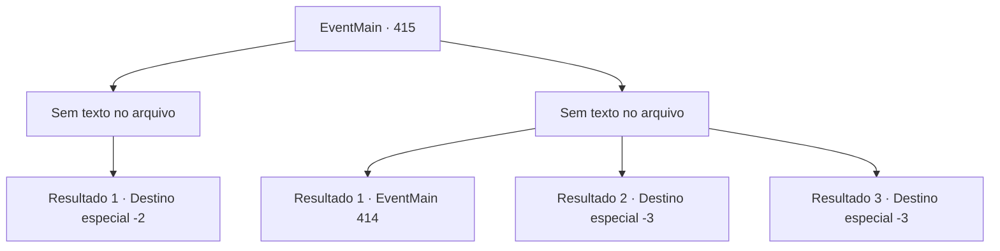

# Eventos principais · 415

[Índice da tabela](index.md) · [Índice geral](../index.md)

ID: `pt:EventMain:415` · Fonte: `EventMain4` · Versão: 1.2.47.

Mapeamento estático dos arquivos; a disponibilidade e a execução dependem do estado da run.

## Texto do evento

*Sem texto no arquivo.*

## Dados de entrada

```json
{
  "id": 415,
  "grade": 1,
  "normalGoal": "",
  "required": ""
}
```

## Mapa das escolhas



## Escolhas e resultados

### Escolha 1

*Sem texto no arquivo; o papel dessa opção depende da interface do jogo.*

Requisitos e outros campos da escolha:

```json
{
  "required": ""
}
```

#### Resultado 1.1

Envolto em raiva, você mata os cobradores de dívidas. Quando Anton descobrir, ele certamente fará algo terrível com sua irmã. Agora, a única opção que resta para você é tirá-la do coliseu antes que Anton descubra o que você fez. Você se dirige apressadamente para 'Romb', a cidade onde o coliseu está localizado.

Continuação registrada: [Destino especial `-2`](../destinos-especiais.md).

```json
{
  "required": "",
  "chance": "1",
  "nextEvent": -2,
  "type": 2,
  "reward": "13_3_13|0_3_-5|0_1_1|5_244_4"
}
```

### Escolha 2

*Sem texto no arquivo; o papel dessa opção depende da interface do jogo.*

Requisitos e outros campos da escolha:

```json
{
  "required": ""
}
```

#### Resultado 2.1

Você está sendo intimidado pelos cobradores de dívidas. 

 "Heh... pedaço de merda. Você acha que não recebemos clientes como você com frequência?"

 Eles cospem em você e roubam o ouro dos seus bolsos. Então, um velho aparece do nada, estala a língua e fala com você. 

 "Eles nunca vão te deixar livre. Não importa o quanto você pague... a dívida não vai desaparecer."


Continuação registrada: [Evento 414](0414.md) na mesma tabela.

```json
{
  "required": "1_0_2|1_1_2",
  "chance": "1",
  "nextEvent": 414,
  "type": 2,
  "reward": "0_4_-200|5_244_1|0_0_-1|0_1_-1"
}
```

#### Resultado 2.2

Você está esmagado pelos cobradores de dívidas. Mas mesmo depois de estar deitado no chão indefeso, eles não param. Infelizmente, você é chutado até a morte pelos cobradores de dívidas.

Continuação registrada: [Destino especial `-3`](../destinos-especiais.md).

```json
{
  "required": "2_0_2",
  "chance": "1",
  "nextEvent": -3,
  "type": 2,
  "reward": "0_0_-1|0_1_-1"
}
```

#### Resultado 2.3

Você está esmagado pelos cobradores de dívidas. Mas mesmo depois de estar deitado no chão indefeso, eles não param. Infelizmente, você é chutado até a morte pelos cobradores de dívidas.

Continuação registrada: [Destino especial `-3`](../destinos-especiais.md).

```json
{
  "required": "2_1_2",
  "chance": "1",
  "nextEvent": -3,
  "type": 2,
  "reward": "0_0_-1|0_1_-1"
}
```

## Referências que chegam a este evento

- [Evento 412 · escolha 3 · resultado 1](0412.md#escolha-3)
- [Evento 413 · escolha 4 · resultado 1](0413.md#escolha-4)
