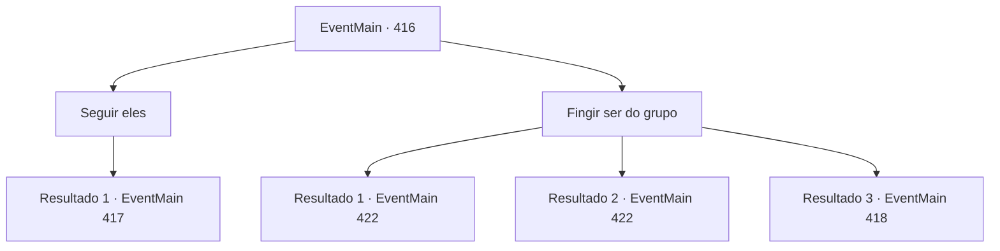

# Eventos principais · 416

[Índice da tabela](index.md) · [Índice geral](../index.md)

ID: `pt:EventMain:416` · Fonte: `EventMain4` · Versão: 1.2.47.

Mapeamento estático dos arquivos; a disponibilidade e a execução dependem do estado da run.

## Texto do evento

Você chega em Romb, a cidade onde fica o Coliseu. É uma cidade construída sobre um enorme penhasco rochoso costeiro. O nevoeiro do mar e a chuva fazem parte do dia-a-dia das pessoas de Romb. Pela aparência, o lugar parece um lugar horrível para se viver, mas o tamanho da cidade é incrível. O sol está quase se pondo, então está meio escuro, mas você pode ver o enorme coliseu daqui. Você decide apressar seus passos. Depois de alguns minutos, você se depara com uma longa fila de pessoas acorrentadas. |drawing_chainWalk| Cerca de dez pessoas, com as mãos e os pés acorrentados, caminham em direção ao Coliseu. Eles estão andando ao lado de um número igual de figuras negras encapuzadas.

## Dados de entrada

```json
{
  "id": 416,
  "grade": 1,
  "normalGoal": "",
  "required": "13_3_13|1_2_100"
}
```

## Mapa das escolhas



## Escolhas e resultados

### Escolha 1

Seguir eles

Requisitos e outros campos da escolha:

```json
{
  "required": ""
}
```

#### Resultado 1.1

Você segue a fila de pessoas de longe. Eles se dirigem ao coliseu, localizado nos arredores de Romb. Eles entram por uma porta de madeira escondida entre as árvores e arbustos. Aparentemente, a porta não é tão grande, pois eles entram um por um. Depois que todos entraram, a porta se fecha. Depois de um tempo, você se aproxima da porta escondida nos fundos do coliseu. Mas no lugar onde a porta estava, não há nada além de arbustos densos e uma parede de pedra. Parece que há um feitiço que está escondendo a porta.

Continuação registrada: [Evento 417](0417.md) na mesma tabela.

```json
{
  "required": "",
  "chance": "1",
  "nextEvent": 417,
  "type": 2,
  "reward": ""
}
```

### Escolha 2

Fingir ser do grupo

Requisitos e outros campos da escolha:

```json
{
  "required": ""
}
```

#### Resultado 2.1

Você o mistura com a linha de pessoas acorrentadas. Eles seguem a liderança das figuras armadas, entrando por uma porta escondida entre as árvores e arbustos. A porta não é tão grande. Apenas uma pessoa entra imediatamente. Depois de uma longa caminhada, você chega ao fim da escada e chega a uma prisão subterrânea. |drawing_lomhnePrison| Depois que todos entraram no buraco dentro da prisão, a voz de alguém ecoa através das paredes. 

 "Bem -vindo, cativos. Agora, tudo o que você precisa fazer é trabalhar duro para pagar suas dívidas. Você não poderá deixar este lugar antes que suas dívidas sejam resolvidas. Se você fugir, isso só tornará muito mais a vida de seus parentes e famílias. Portanto, não tente nada engraçado. Agora, todos vocês têm um quarto designado. Deve ter seu nome e o valor restante da dívida, respectivamente. Encontre -os e entre."

 Depois disso, os guardas desencadeiam os prisioneiros e ordenam que eles fossem para suas células.

Continuação registrada: [Evento 422](0422.md) na mesma tabela.

```json
{
  "required": "",
  "chance": "1|0_6_1",
  "nextEvent": 422,
  "type": 0,
  "reward": ""
}
```

#### Resultado 2.2

Você o mistura com a linha de pessoas acorrentadas. Eles seguem a liderança das figuras armadas, entrando por uma porta escondida entre as árvores e arbustos. A porta não é tão grande. Apenas uma pessoa entra imediatamente. Depois de uma longa caminhada, você chega ao fim da escada e chega a uma prisão subterrânea. |drawing_lomhnePrison| Depois que todos entraram no buraco dentro da prisão, a voz de alguém ecoa através das paredes. 

 "Bem -vindo, cativos. Agora, tudo o que você precisa fazer é trabalhar duro para pagar suas dívidas. Você não poderá deixar este lugar antes que suas dívidas sejam resolvidas. Se você fugir, isso só tornará muito mais a vida de seus parentes e famílias. Portanto, não tente nada engraçado. Agora, todos vocês têm um quarto designado. Deve ter seu nome e o valor restante da dívida, respectivamente. Encontre -os e entre."

 Depois disso, os guardas desencadeiam os prisioneiros e ordenam que eles fossem para suas células.

Continuação registrada: [Evento 422](0422.md) na mesma tabela.

```json
{
  "required": "20_5_2",
  "chance": "1|0_6_1",
  "nextEvent": 422,
  "type": 0,
  "reward": ""
}
```

#### Resultado 2.3

Você tenta se misturar com a linha de pessoas encadeadas. Mas então, uma mulher usando um capuz preto te avista e pergunta. 

 "Ei, você. Sim, você. O que você está tentando fazer?"

 Ela nem mesmo ouve sua resposta. Ela pula em cima de você.

Continuação registrada: [Evento 418](0418.md) na mesma tabela.

```json
{
  "required": "",
  "chance": "22",
  "nextEvent": 418,
  "type": 1,
  "reward": "6_0_123",
  "place": 4
}
```

## Referências que chegam a este evento

Nenhum `nextEvent` positivo da mesma tabela aponta para este nó. Isso não prova que seja inacessível: sorteio e estado de história podem selecioná-lo.

