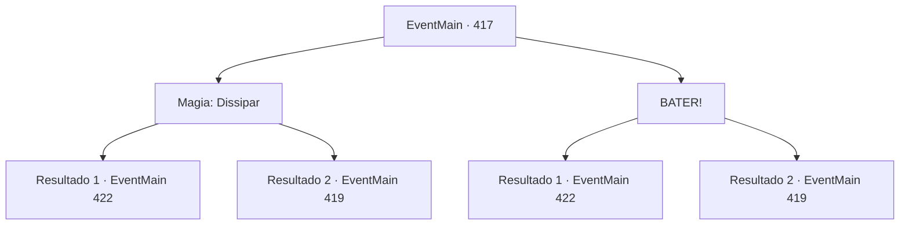

# Eventos principais · 417

[Índice da tabela](index.md) · [Índice geral](../index.md)

ID: `pt:EventMain:417` · Fonte: `EventMain4` · Versão: 1.2.47.

Mapeamento estático dos arquivos; a disponibilidade e a execução dependem do estado da run.

## Texto do evento

*Sem texto no arquivo.*

## Dados de entrada

```json
{
  "id": 417,
  "grade": 1,
  "normalGoal": "",
  "required": ""
}
```

## Mapa das escolhas



## Escolhas e resultados

### Escolha 1

Magia: Dissipar

Requisitos e outros campos da escolha:

```json
{
  "required": "20_0_2|1_1_2"
}
```

#### Resultado 1.1

Você se concentra e dissipa a magia que está escondendo a porta. A porta secreta escondida aparece diante de você, e você a abre cuidadosamente e entra. Uma escada longa e estreita se revela. Depois de uma longa caminhada, você chega ao final da escada, chegando em uma prisão subterrânea. |drawing_lomhnePrison| Depois que todos entraram no buraco dentro da prisão, a voz de alguém ecoa através das paredes. 

 "Bem -vindo, cativos. Agora, tudo o que você precisa fazer é trabalhar duro para pagar suas dívidas. Você não poderá deixar este lugar antes que suas dívidas sejam resolvidas. Se você fugir, isso só tornará muito mais a vida de seus parentes e famílias. Portanto, não tente nada engraçado. Agora, todos vocês têm um quarto designado. Deve ter seu nome e o valor restante da dívida, respectivamente. Encontre -os e entre."

 Depois disso, os guardas desencadeiam os prisioneiros e ordenam que eles fossem para suas células.

Continuação registrada: [Evento 422](0422.md) na mesma tabela.

```json
{
  "required": "",
  "chance": "1|0_7_1|0_12_1",
  "nextEvent": 422,
  "type": 0,
  "reward": "0_1_-1"
}
```

#### Resultado 1.2

Tentas dissipar a magia que está a esconder a porta. Mas falhas. Apenas uma imagem fraca de uma porta aparece e desaparece rapidamente. Sentes um forte vertigem, provavelmente do contra-ataque do feitiço, e dás um passo atrás. Então, a porta abre-se completamente e uma mulher usando um capuz preto aparece. Ela examina-te de cima a baixo e fala. 

 "...Tu acabaste de tentar abrir a porta?"


Continuação registrada: [Evento 419](0419.md) na mesma tabela.

```json
{
  "required": "",
  "chance": "25",
  "nextEvent": 419,
  "type": 1,
  "reward": "0_1_-1"
}
```

### Escolha 2

BATER!

Requisitos e outros campos da escolha:

```json
{
  "required": ""
}
```

#### Resultado 2.1

Você corre em direção ao local onde estava a porta e bate nela. Com uma rachadura alta, a porta se abre. Parece que a magia foi quebrada com ela. Uma escada longa e estreita se revela. Depois de uma longa caminhada, você chega ao final da escada, chegando em uma prisão subterrânea. |drawing_lomhnePrison| Depois que todos entraram no buraco dentro da prisão, a voz de alguém ecoa através das paredes. 

 "Bem -vindo, cativos. Agora, tudo o que você precisa fazer é trabalhar duro para pagar suas dívidas. Você não poderá deixar este lugar antes que suas dívidas sejam resolvidas. Se você fugir, isso só tornará muito mais a vida de seus parentes e famílias. Portanto, não tente nada engraçado. Agora, todos vocês têm um quarto designado. Deve ter seu nome e o valor restante da dívida, respectivamente. Encontre -os e entre."

 Depois disso, os guardas desencadeiam os prisioneiros e ordenam que eles fossem para suas células.

Continuação registrada: [Evento 422](0422.md) na mesma tabela.

```json
{
  "required": "",
  "chance": "1|0_5_1|0_13_1",
  "nextEvent": 422,
  "type": 0,
  "reward": ""
}
```

#### Resultado 2.2

Você corre em direção ao lugar onde a porta estava e bate nela. Um alto estalo pode ser ouvido, mas parece que a porta ainda está intacta. Você esfrega o ombro enquanto sente a dor e dá um passo para trás. Então, a porta se abre completamente e uma mulher usando um capuz preto aparece. Ela te examina de cima a baixo e fala. 

 "...Você acabou de tentar abrir a porta?"


Continuação registrada: [Evento 419](0419.md) na mesma tabela.

```json
{
  "required": "",
  "chance": "16",
  "nextEvent": 419,
  "type": 1,
  "reward": ""
}
```

## Referências que chegam a este evento

- [Evento 416 · escolha 1 · resultado 1](0416.md#escolha-1)
