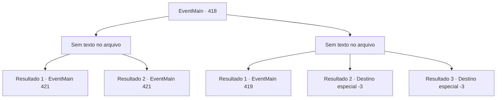

# Eventos principais · 418

[Índice da tabela](index.md) · [Índice geral](../index.md)

ID: `pt:EventMain:418` · Fonte: `EventMain4` · Versão: 1.2.47.

Mapeamento estático dos arquivos; a disponibilidade e a execução dependem do estado da run.

## Texto do evento

*Sem texto no arquivo.*

## Dados de entrada

```json
{
  "id": 418,
  "grade": 1,
  "normalGoal": "",
  "required": ""
}
```

## Mapa das escolhas



## Escolhas e resultados

### Escolha 1

*Sem texto no arquivo; o papel dessa opção depende da interface do jogo.*

Requisitos e outros campos da escolha:

```json
{
  "required": ""
}
```

#### Resultado 1.1

Você derrota a vampira. Ela se transforma em um monte de cinzas, e as pessoas acorrentadas assistem à cena se desenrolar em espanto. Encontrado no monte de cinzas está uma chave que abrirá as correntes. Mas ninguém parece ansioso para pegar a chave e escapar.

Continuação registrada: [Evento 421](0421.md) na mesma tabela.

```json
{
  "required": "23_2_1",
  "chance": "1",
  "nextEvent": 421,
  "type": 2,
  "reward": ""
}
```

#### Resultado 1.2

Você derrota a vampira. Mas logo ela coloca seu pescoço quebrado em seu corpo e se levanta. Então, as pessoas acorrentadas batem em sua cabeça com suas correntes. A vampira grita agudamente e se dissipa no ar como névoa. Onde a vampira estava, há apenas uma chave que abrirá as correntes. Mas ninguém parece ansioso para pegar a chave e escapar.

Continuação registrada: [Evento 421](0421.md) na mesma tabela.

```json
{
  "required": "24_2_1",
  "chance": "1",
  "nextEvent": 421,
  "type": 2,
  "reward": ""
}
```

### Escolha 2

*Sem texto no arquivo; o papel dessa opção depende da interface do jogo.*

Requisitos e outros campos da escolha:

```json
{
  "required": ""
}
```

#### Resultado 2.1

A vampira te derrota e se vira, como se não estivesse interessada. Ela então leva as pessoas acorrentadas para dentro do coliseu. Você acorda novamente e massageia suas feridas. Quando você se aproxima da porta novamente, a porta se abre desta vez. A vampira aparece novamente. Ela te examina de cima a baixo e fala. 

 "...Você acabou de tentar abrir a porta?"


Continuação registrada: [Evento 419](0419.md) na mesma tabela.

```json
{
  "required": "1_0_2|1_1_2",
  "chance": "1",
  "nextEvent": 419,
  "type": 2,
  "reward": "0_0_-1|0_1_-1"
}
```

#### Resultado 2.2

A vampira rasga seu pescoço com suas garras, e você desaba jorrando sangue.

Continuação registrada: [Destino especial `-3`](../destinos-especiais.md).

```json
{
  "required": "2_0_2",
  "chance": "1",
  "nextEvent": -3,
  "type": 2,
  "reward": "0_0_-1|0_1_-1"
}
```

#### Resultado 2.3

A vampira rasga seu pescoço com suas garras, e você desaba jorrando sangue.

Continuação registrada: [Destino especial `-3`](../destinos-especiais.md).

```json
{
  "required": "2_1_2",
  "chance": "1",
  "nextEvent": -3,
  "type": 2,
  "reward": "0_0_-1|0_1_-1"
}
```

## Referências que chegam a este evento

- [Evento 416 · escolha 2 · resultado 3](0416.md#escolha-2)
