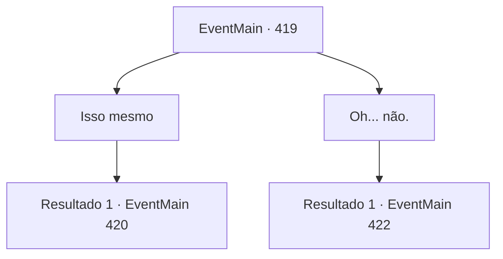

# Eventos principais · 419

[Índice da tabela](index.md) · [Índice geral](../index.md)

ID: `pt:EventMain:419` · Fonte: `EventMain4` · Versão: 1.2.47.

Mapeamento estático dos arquivos; a disponibilidade e a execução dependem do estado da run.

## Texto do evento

*Sem texto no arquivo.*

## Dados de entrada

```json
{
  "id": 419,
  "grade": 1,
  "normalGoal": "",
  "required": ""
}
```

## Mapa das escolhas



## Escolhas e resultados

### Escolha 1

Isso mesmo

Requisitos e outros campos da escolha:

```json
{
  "required": ""
}
```

#### Resultado 1.1

Quando você diz sim, a vampira responde de forma bastante comum. 

 "Meu trabalho é garantir que os cativos cheguem em segurança ao coliseu. Manter a porta fechada não é minha responsabilidade."

 Após terminar, ela se afasta e faz um gesto para que você entre.

Continuação registrada: [Evento 420](0420.md) na mesma tabela.

```json
{
  "required": "",
  "chance": "1",
  "nextEvent": 420,
  "type": 2,
  "reward": ""
}
```

### Escolha 2

Oh... não.

Requisitos e outros campos da escolha:

```json
{
  "required": ""
}
```

#### Resultado 2.1

Você diz a ela que não é o que você estava tentando fazer. A vampira fecha a porta e desaparece. A porta fechada se torna invisível. Você pega a maçaneta e a abre com cuidado. Você não tem certeza se a vampira está ignorando você ou simplesmente não notou você. Mas, no entanto, ela apenas se afasta. Você vai para dentro. Uma escada longa e estreita se revela. Depois de uma longa caminhada, você chega ao final da escada, chegando em uma prisão subterrânea. |drawing_lomhnePrison| Depois que todos entraram no buraco dentro da prisão, a voz de alguém ecoa através das paredes. 

 "Bem -vindo, cativos. Agora, tudo o que você precisa fazer é trabalhar duro para pagar suas dívidas. Você não poderá deixar este lugar antes que suas dívidas sejam resolvidas. Se você fugir, isso só tornará muito mais a vida de seus parentes e famílias. Portanto, não tente nada engraçado. Agora, todos vocês têm um quarto designado. Deve ter seu nome e o valor restante da dívida, respectivamente. Encontre -os e entre."

 Depois disso, os guardas desencadeiam os prisioneiros e ordenam que eles fossem para suas células.

Continuação registrada: [Evento 422](0422.md) na mesma tabela.

```json
{
  "required": "",
  "chance": "1",
  "nextEvent": 422,
  "type": 2,
  "reward": ""
}
```

## Referências que chegam a este evento

- [Evento 417 · escolha 1 · resultado 2](0417.md#escolha-1)
- [Evento 417 · escolha 2 · resultado 2](0417.md#escolha-2)
- [Evento 418 · escolha 2 · resultado 1](0418.md#escolha-2)
