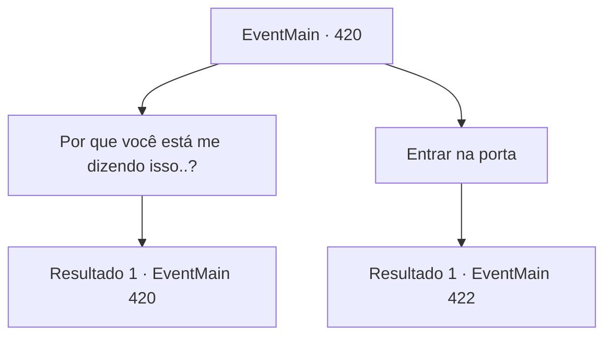

# Eventos principais · 420

[Índice da tabela](index.md) · [Índice geral](../index.md)

ID: `pt:EventMain:420` · Fonte: `EventMain4` · Versão: 1.2.47.

Mapeamento estático dos arquivos; a disponibilidade e a execução dependem do estado da run.

## Texto do evento

*Sem texto no arquivo.*

## Dados de entrada

```json
{
  "id": 420,
  "grade": 1,
  "normalGoal": "",
  "required": ""
}
```

## Mapa das escolhas



## Escolhas e resultados

### Escolha 1

Por que você está me dizendo isso..?

Requisitos e outros campos da escolha:

```json
{
  "required": "5_282_0"
}
```

#### Resultado 1.1

A vampira responde com um encolher de ombros. 

 "Bem... Vamos dizer que eu não gosto muito do Anton. Acho que é assim que a maioria dos vampiros aqui pensa. Eles abominam o mestre deles. A única coisa que mantém a ordem é o poder do Anton."

 Ela solta um suspiro e continua. 

 "Sabe de uma coisa? Acho que o Anton está tramando colocar uma faca nas costas do Senhor também. Ou não. De qualquer forma, tudo o que tenho que fazer é o que me foi ordenado. Se você entrar no coliseu ou não, não me importo nem um pouco."

 A vampira diz que espera que tenha ajudado.

Continuação registrada: [Evento 420](0420.md) na mesma tabela.

```json
{
  "required": "",
  "chance": "1",
  "nextEvent": 420,
  "type": 2,
  "reward": "5_282_1"
}
```

### Escolha 2

Entrar na porta

Requisitos e outros campos da escolha:

```json
{
  "required": ""
}
```

#### Resultado 2.1

Você vai cuidadosamente para dentro. Quando você entra no corredor, a vampira fecha a porta fechada. Uma escada longa e estreita se revela. Depois de uma longa caminhada, você chega ao final da escada, chegando em uma prisão subterrânea. |drawing_lomhnePrison| Depois que todos entraram no buraco dentro da prisão, a voz de alguém ecoa através das paredes. 

 "Bem -vindo, cativos. Agora, tudo o que você precisa fazer é trabalhar duro para pagar suas dívidas. Você não poderá deixar este lugar antes que suas dívidas sejam resolvidas. Se você fugir, isso só tornará muito mais a vida de seus parentes e famílias. Portanto, não tente nada engraçado. Agora, todos vocês têm um quarto designado. Deve ter seu nome e o valor restante da dívida, respectivamente. Encontre -os e entre."

 Depois disso, os guardas desencadeiam os prisioneiros e ordenam que eles fossem para suas células.

Continuação registrada: [Evento 422](0422.md) na mesma tabela.

```json
{
  "required": "",
  "chance": "1",
  "nextEvent": 422,
  "type": 2,
  "reward": ""
}
```

## Referências que chegam a este evento

- [Evento 419 · escolha 1 · resultado 1](0419.md#escolha-1)
- [Evento 420 · escolha 1 · resultado 1](0420.md#escolha-1)
