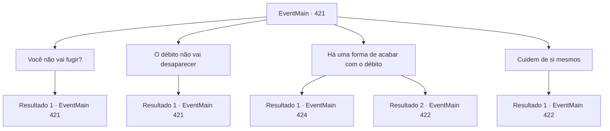

# Eventos principais · 421

[Índice da tabela](index.md) · [Índice geral](../index.md)

ID: `pt:EventMain:421` · Fonte: `EventMain4` · Versão: 1.2.47.

Mapeamento estático dos arquivos; a disponibilidade e a execução dependem do estado da run.

## Texto do evento

*Sem texto no arquivo.*

## Dados de entrada

```json
{
  "id": 421,
  "grade": 1,
  "normalGoal": "",
  "required": ""
}
```

## Mapa das escolhas



## Escolhas e resultados

### Escolha 1

Você não vai fugir?

Requisitos e outros campos da escolha:

```json
{
  "required": "5_281_0"
}
```

#### Resultado 1.1

Você pergunta às pessoas por que elas não estão fugindo. Então, um menino responde. 

 "...Se eu fugir, disseram que minha família vai sofrer."

 Todos os outros concordam com a cabeça. As pessoas aqui foram trazidas para cá por um motivo específico - como garantia de dívida. Eles dizem que não querem que suas famílias restantes sofram.

Continuação registrada: [Evento 421](0421.md) na mesma tabela.

```json
{
  "required": "",
  "chance": "1",
  "nextEvent": 421,
  "type": 2,
  "reward": "5_281_1"
}
```

### Escolha 2

O débito não vai desaparecer

Requisitos e outros campos da escolha:

```json
{
  "required": "5_281_1"
}
```

#### Resultado 2.1

Você conta a eles o que o velho lhe disse. Que não importa o quanto eles trabalhem, a dívida não vai desaparecer. Os rostos das pessoas começam a escurecer de preocupação. 

 "Então... então o que devemos fazer?"

 Um homem pergunta preocupado.

Continuação registrada: [Evento 421](0421.md) na mesma tabela.

```json
{
  "required": "",
  "chance": "1",
  "nextEvent": 421,
  "type": 2,
  "reward": "5_281_2"
}
```

### Escolha 3

Há uma forma de acabar com o débito

Requisitos e outros campos da escolha:

```json
{
  "required": "5_281_2"
}
```

#### Resultado 3.1

Você chama a atenção do povo com seu carisma. Você diz a eles que há uma maneira de encerrar a cadeia de dívidas sem fim. Isto é, você diz, para se livrar daqueles que vêm cobrar a dívida. Quanto mais as pessoas o ouvem, mais seus rostos ficam energizados com esperança. Você os liberta de suas correntes e vai para a entrada secreta. Uma escada longa e estreita se revela. Depois de uma longa caminhada, você chega ao final da escada, chegando em uma prisão subterrânea. |drawing_lomhnePrison| A prisão tem muitas células, com os nomes dos presos e a quantidade de dívida sob seus nomes escritos neles. Você vê guardas patrulhando ao redor das células. 

 "Então, tudo o que precisamos fazer é derrotar os aqui, certo ..?"

 O homem de meia idade que fez a pergunta logo cobra em um dos guardas. Outras pessoas seguem o exemplo. 

 "W ... que diabos ...!"

 Os guardas ficam surpresos, mas logo revidam com os dentes e garras. Você os vê e percebe que eles são vampiros.

Continuação registrada: [Evento 424](0424.md) na mesma tabela.

```json
{
  "required": "",
  "chance": "1|0_12_1",
  "nextEvent": 424,
  "type": 0,
  "reward": "5_281_3"
}
```

#### Resultado 3.2

Você chama a atenção do povo com seu carisma. Você diz a eles que há uma maneira de encerrar a cadeia de dívidas sem fim. Isto é, você diz, para se livrar daqueles que vêm cobrar a dívida. Mas as pessoas parecem muito medo de seguir seu plano. Infelizmente, você entra sozinho dentro do corredor secreto do Coliseu. Depois de uma longa caminhada, você chega ao final da escada, chegando em uma prisão subterrânea. |drawing_lomhnePrison| A prisão tem muitas células, com os nomes dos presos e a quantidade de dívida sob seus nomes escritos neles. Você vê guardas patrulhando ao redor das células. 

Continuação registrada: [Evento 422](0422.md) na mesma tabela.

```json
{
  "required": "",
  "chance": "14",
  "nextEvent": 422,
  "type": 1,
  "reward": "5_281_4"
}
```

### Escolha 4

Cuidem de si mesmos

Requisitos e outros campos da escolha:

```json
{
  "required": "5_281_2"
}
```

#### Resultado 4.1

Você decide não ajudá -los. Eles parecem que não querem sua ajuda, afinal. As pessoas começam a conversar umas com as outras. Deixando -os para trás, você entra no corredor secreto do Coliseu. Depois de uma longa caminhada, você chega ao final da escada, chegando em uma prisão subterrânea. |drawing_lomhnePrison| A prisão tem muitas células, com os nomes dos presos e a quantidade de dívida sob seus nomes escritos neles. Você vê guardas patrulhando ao redor das células. 

Continuação registrada: [Evento 422](0422.md) na mesma tabela.

```json
{
  "required": "",
  "chance": "1",
  "nextEvent": 422,
  "type": 2,
  "reward": "5_281_4"
}
```

## Referências que chegam a este evento

- [Evento 418 · escolha 1 · resultado 1](0418.md#escolha-1)
- [Evento 418 · escolha 1 · resultado 2](0418.md#escolha-1)
- [Evento 421 · escolha 1 · resultado 1](0421.md#escolha-1)
- [Evento 421 · escolha 2 · resultado 1](0421.md#escolha-2)
