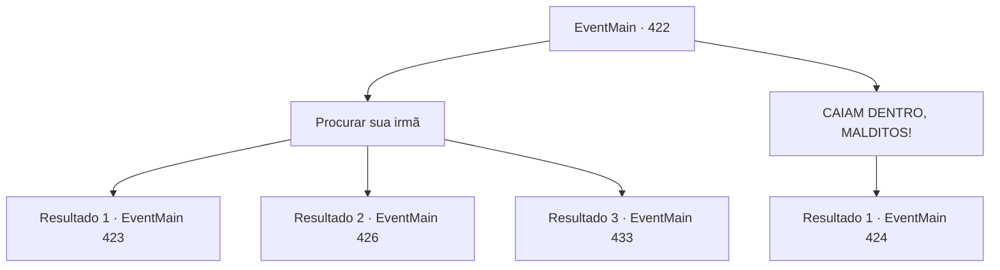

# Eventos principais · 422

[Índice da tabela](index.md) · [Índice geral](../index.md)

ID: `pt:EventMain:422` · Fonte: `EventMain4` · Versão: 1.2.47.

Mapeamento estático dos arquivos; a disponibilidade e a execução dependem do estado da run.

## Texto do evento

*Sem texto no arquivo.*

## Dados de entrada

```json
{
  "id": 422,
  "grade": 1,
  "normalGoal": "",
  "required": ""
}
```

## Mapa das escolhas



## Escolhas e resultados

### Escolha 1

Procurar sua irmã

Requisitos e outros campos da escolha:

```json
{
  "required": ""
}
```

#### Resultado 1.1

Você procura cuidadosamente pela cela da sua irmã, se escondendo dos guardas. E logo, você se depara com uma sala com 'Fiana' escrito nela. Você decide abrir a porta, na esperança de ver sua irmã. Então, um dos guardas te encontra e fala. 

 "Você aí. Pare de bisbilhotar e volte para o seu quarto. Você tem 10 segundos."


Continuação registrada: [Evento 423](0423.md) na mesma tabela.

```json
{
  "required": "18_281_4",
  "chance": "1",
  "nextEvent": 423,
  "type": 2,
  "reward": ""
}
```

#### Resultado 1.2

Você procura cuidadosamente pela cela da sua irmã, escondendo-se dos guardas. E logo, você se depara com uma sala com 'Fiana' escrito nela. Você decide abrir a porta, na esperança de ver sua irmã. É fácil abrir a porta por fora. Você puxa a pesada porta de ferro e encontra sua irmãzinha dentro da cela. Seus olhos castanhos, a princípio, ficam desconfiados, mas logo se enchem de lágrimas ao reconhecer você.

Continuação registrada: [Evento 426](0426.md) na mesma tabela.

```json
{
  "required": "5_281_4|18_244_4",
  "chance": "1",
  "nextEvent": 426,
  "type": 2,
  "reward": ""
}
```

#### Resultado 1.3

Você procura cuidadosamente pela cela da sua irmã, se escondendo dos guardas. E logo, você se depara com uma sala com 'Fiana' escrito nela. Você decide abrir a porta, na esperança de ver sua irmã. É fácil abrir a porta por fora. Você puxa a pesada porta de ferro, mas não há ninguém dentro. Você sai imediatamente da cela e explora o corredor. Você encontra uma escada que leva a um porão ainda mais profundo. Você pode ouvir os gritos de alguém vindo de lá.

Continuação registrada: [Evento 433](0433.md) na mesma tabela.

```json
{
  "required": "5_281_4|5_244_4",
  "chance": "1",
  "nextEvent": 433,
  "type": 2,
  "reward": ""
}
```

### Escolha 2

CAIAM DENTRO, MALDITOS!

Requisitos e outros campos da escolha:

```json
{
  "required": ""
}
```

#### Resultado 2.1

Assim que você entra na prisão subterrânea, você grita uma provocação. Sua voz ecoa pelas paredes da prisão, e os guardas correm em sua direção com os olhos brilhando vermelhos. Você os vê e percebe que eles são vampiros.

Continuação registrada: [Evento 424](0424.md) na mesma tabela.

```json
{
  "required": "",
  "chance": "1",
  "nextEvent": 424,
  "type": 2,
  "reward": ""
}
```

## Referências que chegam a este evento

- [Evento 416 · escolha 2 · resultado 1](0416.md#escolha-2)
- [Evento 416 · escolha 2 · resultado 2](0416.md#escolha-2)
- [Evento 417 · escolha 1 · resultado 1](0417.md#escolha-1)
- [Evento 417 · escolha 2 · resultado 1](0417.md#escolha-2)
- [Evento 419 · escolha 2 · resultado 1](0419.md#escolha-2)
- [Evento 420 · escolha 2 · resultado 1](0420.md#escolha-2)
- [Evento 421 · escolha 3 · resultado 2](0421.md#escolha-3)
- [Evento 421 · escolha 4 · resultado 1](0421.md#escolha-4)
