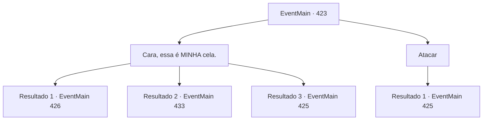

# Eventos principais · 423

[Índice da tabela](index.md) · [Índice geral](../index.md)

ID: `pt:EventMain:423` · Fonte: `EventMain4` · Versão: 1.2.47.

Mapeamento estático dos arquivos; a disponibilidade e a execução dependem do estado da run.

## Texto do evento

*Sem texto no arquivo.*

## Dados de entrada

```json
{
  "id": 423,
  "grade": 1,
  "normalGoal": "",
  "required": ""
}
```

## Mapa das escolhas



## Escolhas e resultados

### Escolha 1

Cara, essa é MINHA cela.

Requisitos e outros campos da escolha:

```json
{
  "required": ""
}
```

#### Resultado 1.1

O guarda inclina a cabeça confuso, mas decide seguir em frente. Ele abre a porta ele mesmo. Dentro daquela cela está sua irmãzinha, Fiana. Seus olhos castanhos, a princípio, ficam desconfiados, mas logo se enchem de lágrimas ao reconhecer você. 

 "O que você está fazendo...!"

 O guarda percebe que a cela já está ocupada e tenta olhar para trás, para você. Mas você dá um tapa na parte de trás da cabeça dele. O guarda se dissipa no ar como névoa.

Continuação registrada: [Evento 426](0426.md) na mesma tabela.

```json
{
  "required": "18_244_4",
  "chance": "1|0_12_1",
  "nextEvent": 426,
  "type": 0,
  "reward": ""
}
```

#### Resultado 1.2

O guarda inclina a cabeça confuso, mas decide seguir em frente. Ele abre a porta ele mesmo. Mas não há ninguém dentro da cela. O guarda empurra você para dentro da cela e fecha a porta. Você encontra uma escada que leva a um porão ainda mais profundo. Você pode ouvir os gritos de alguém vindo de lá.

Continuação registrada: [Evento 433](0433.md) na mesma tabela.

```json
{
  "required": "5_244_4",
  "chance": "1|0_12_1",
  "nextEvent": 433,
  "type": 0,
  "reward": ""
}
```

#### Resultado 1.3


 "Heh... Sim, claro. Não vai funcionar."

 Sua atuação desajeitada só enfurece o guarda. Ele revela garras afiadas e começa a balançá-las em sua direção.

Continuação registrada: [Evento 425](0425.md) na mesma tabela.

```json
{
  "required": "",
  "chance": "12",
  "nextEvent": 425,
  "type": 1,
  "reward": "6_0_19",
  "place": 7
}
```

### Escolha 2

Atacar

Requisitos e outros campos da escolha:

```json
{
  "required": ""
}
```

#### Resultado 2.1

Você não responde a ele, mas em vez disso o ataca.

Continuação registrada: [Evento 425](0425.md) na mesma tabela.

```json
{
  "required": "",
  "chance": "1",
  "nextEvent": 425,
  "type": 2,
  "reward": "6_0_19",
  "place": 7
}
```

## Referências que chegam a este evento

- [Evento 422 · escolha 1 · resultado 1](0422.md#escolha-1)
