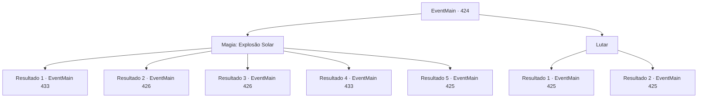

# Eventos principais · 424

[Índice da tabela](index.md) · [Índice geral](../index.md)

ID: `pt:EventMain:424` · Fonte: `EventMain4` · Versão: 1.2.47.

Mapeamento estático dos arquivos; a disponibilidade e a execução dependem do estado da run.

## Texto do evento

*Sem texto no arquivo.*

## Dados de entrada

```json
{
  "id": 424,
  "grade": 1,
  "normalGoal": "",
  "required": ""
}
```

## Mapa das escolhas



## Escolhas e resultados

### Escolha 1

Magia: Explosão Solar

Requisitos e outros campos da escolha:

```json
{
  "required": "20_0_4|1_1_2"
}
```

#### Resultado 1.1

Você reúne parte de sua concentração no último momento, você lança um feitiço para imitar a luz do sol. Uma explosão brilhante de luz sai e os vampiros se transformam em cinzas. Você olha ao redor e encontra uma cela com 'Fiana' escrito nela. Você vai imediatamente para lá e abre a porta. Mas não há ninguém lá dentro. Você sai dessa cela e olha ao redor. Você encontra uma escada que leva a um porão ainda mais profundo. Você pode ouvir os gritos de alguém vindo de lá.

Continuação registrada: [Evento 433](0433.md) na mesma tabela.

```json
{
  "required": "18_281_3|5_244_4",
  "chance": "1|0_14_1",
  "nextEvent": 433,
  "type": 0,
  "reward": "0_1_-1"
}
```

#### Resultado 1.2

Você reúne parte de sua concentração no último instante, lança um feitiço para imitar a luz do sol. Uma explosão brilhante de luz surge e os vampiros se transformam em cinzas. 

 "Ack... o que é isso...?"

 Olhando para a faísca brilhante, as pessoas franzem a testa. Elas olham para as cinzas dos vampiros e ficam assustadas. 

 "Uau... Você não apenas os matou. Você também lhes deu um funeral adequado."

 Você imediatamente se dirige à cela com o nome 'Fiana' escrito nela e abre a porta. Dentro dessa cela está sua irmãzinha, Fiana. Seus olhos castanhos, a princípio, ficam desconfiados, mas logo se enchem de lágrimas ao reconhecer você.

Continuação registrada: [Evento 426](0426.md) na mesma tabela.

```json
{
  "required": "5_281_3|18_244_4",
  "chance": "1|0_14_1",
  "nextEvent": 426,
  "type": 0,
  "reward": "0_1_-1"
}
```

#### Resultado 1.3

Você reúne parte de sua concentração no último momento, você lança um feitiço para imitar a luz do sol. Uma explosão brilhante de luz surge e os vampiros se transformam em cinzas. Você imediatamente se dirige à cela com 'Fiana' escrito nela e abre a porta. Dentro dessa cela está sua irmãzinha, Fiana. Seus olhos castanhos, a princípio, ficam desconfiados, mas logo se enchem de lágrimas ao reconhecer você.

Continuação registrada: [Evento 426](0426.md) na mesma tabela.

```json
{
  "required": "18_281_3|18_244_4",
  "chance": "1|0_14_1",
  "nextEvent": 426,
  "type": 0,
  "reward": "0_1_-1"
}
```

#### Resultado 1.4

Você reúne parte de sua concentração no último momento, lança um feitiço para imitar a luz do sol. Uma explosão brilhante de luz surge e os vampiros se transformam em cinzas. 

 "Ack... o que é isso...?"

 Olhando para a faísca brilhante, as pessoas franzem a testa. Elas olham para as cinzas dos vampiros e ficam assustadas. 

 "Uau... Você não apenas os matou. Você também lhes deu um funeral adequado."

 Você imediatamente se dirige à cela com o nome 'Fiana' escrito nela e abre a porta. Dentro dessa cela está sua irmãzinha, Fiana. Seus olhos castanhos, a princípio, ficam desconfiados, mas logo se enchem de lágrimas ao reconhecer você.

Continuação registrada: [Evento 433](0433.md) na mesma tabela.

```json
{
  "required": "5_281_3|5_244_4",
  "chance": "1|0_14_1",
  "nextEvent": 433,
  "type": 0,
  "reward": "0_1_-1"
}
```

#### Resultado 1.5

Tentas lançar um feitiço para imitar a luz do sol, mas falhas. Decides encontrar uma solução alternativa.

Continuação registrada: [Evento 425](0425.md) na mesma tabela.

```json
{
  "required": "",
  "chance": "13",
  "nextEvent": 425,
  "type": 1,
  "reward": "6_0_19",
  "place": 7
}
```

### Escolha 2

Lutar

Requisitos e outros campos da escolha:

```json
{
  "required": ""
}
```

#### Resultado 2.1

Você começa a lutar contra os vampiros guardiões.

Continuação registrada: [Evento 425](0425.md) na mesma tabela.

```json
{
  "required": "18_281_3",
  "chance": "1",
  "nextEvent": 425,
  "type": 2,
  "reward": "6_3_19",
  "place": 7
}
```

#### Resultado 2.2

Você começa a lutar contra os vampiros guardiões, juntamente com os futuros detentos.

Continuação registrada: [Evento 425](0425.md) na mesma tabela.

```json
{
  "required": "5_281_3",
  "chance": "1",
  "nextEvent": 425,
  "type": 2,
  "reward": "6_0_19",
  "place": 7
}
```

## Referências que chegam a este evento

- [Evento 421 · escolha 3 · resultado 1](0421.md#escolha-3)
- [Evento 422 · escolha 2 · resultado 1](0422.md#escolha-2)
