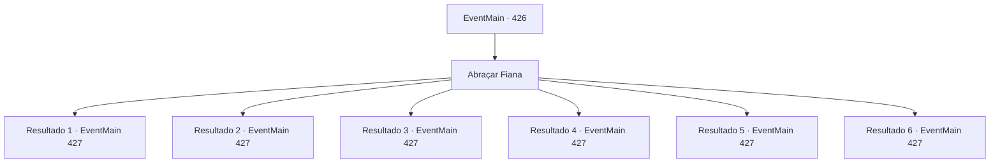

# Eventos principais · 426

[Índice da tabela](index.md) · [Índice geral](../index.md)

ID: `pt:EventMain:426` · Fonte: `EventMain4` · Versão: 1.2.47.

Mapeamento estático dos arquivos; a disponibilidade e a execução dependem do estado da run.

## Texto do evento

*Sem texto no arquivo.*

## Dados de entrada

```json
{
  "id": 426,
  "grade": 1,
  "normalGoal": "",
  "required": ""
}
```

## Mapa das escolhas



## Escolhas e resultados

### Escolha 1

Abraçar Fiana

Requisitos e outros campos da escolha:

```json
{
  "required": ""
}
```

#### Resultado 1.1

|drawing_meetSis| Você abraça sua irmã com força. Ela parece desnutrida, mas ficou mais alta desde a última vez que você a viu. 

 "Irmão..! Senti a sua falta. Muito mesmo. Vamos sair daqui ... Cada moeda que gasto aqui é adicionada à nossa dívida. Se eu bebo uma poção ou compro uma lâmina, é tudo a mesma coisa. Se eu ficar aqui, nunca seremos capazes de pagar nossa dívida."


Continuação registrada: [Evento 427](0427.md) na mesma tabela.

```json
{
  "required": "5_244_0|11_0_0",
  "chance": "1",
  "nextEvent": 427,
  "type": 2,
  "reward": "0_1_1"
}
```

#### Resultado 1.2

|drawing_meetSis| Você abraça sua irmã com força. Ela parece desnutrida, mas ficou mais alta desde a última vez que você a viu. 

 "Irmã..! Senti a sua falta. Muito mesmo. Vamos sair daqui ... Cada moeda que gasto aqui é adicionada à nossa dívida. Se eu bebo uma poção ou compro uma lâmina, é tudo a mesma coisa. Se eu ficar aqui, nunca seremos capazes de pagar nossa dívida."


Continuação registrada: [Evento 427](0427.md) na mesma tabela.

```json
{
  "required": "5_244_0|11_0_1",
  "chance": "1",
  "nextEvent": 427,
  "type": 2,
  "reward": "0_1_1"
}
```

#### Resultado 1.3

|drawing_meetSis| Você abraça sua irmã com força. Ela ganhou muitos músculos desde a última vez que você a viu. Provavelmente de todas as lutas pelas quais ela passou. 

 "Irmão..! Senti a sua falta. Muito mesmo. Vamos sair daqui ... Cada moeda que gasto aqui é adicionada à nossa dívida. Se eu bebo uma poção ou compro uma lâmina, é tudo a mesma coisa. Se eu ficar aqui, nunca seremos capazes de pagar nossa dívida."


Continuação registrada: [Evento 427](0427.md) na mesma tabela.

```json
{
  "required": "5_244_1|11_0_0",
  "chance": "1",
  "nextEvent": 427,
  "type": 2,
  "reward": "0_1_1"
}
```

#### Resultado 1.4

|drawing_meetSis| Você abraça sua irmã com força. Ela ganhou muitos músculos desde a última vez que você a viu. Provavelmente de todas as lutas pelas quais ela passou. 

 "Irmã..! Senti a sua falta. Muito mesmo. Vamos sair daqui ... Cada moeda que gasto aqui é adicionada à nossa dívida. Se eu bebo uma poção ou compro uma lâmina, é tudo a mesma coisa. Se eu ficar aqui, nunca seremos capazes de pagar nossa dívida."


Continuação registrada: [Evento 427](0427.md) na mesma tabela.

```json
{
  "required": "5_244_1|11_0_1",
  "chance": "1",
  "nextEvent": 427,
  "type": 2,
  "reward": "0_1_1"
}
```

#### Resultado 1.5

|drawing_meetSis| Você abraça sua irmã com força. Seu corpo está coberto de hematomas e cortes, provavelmente de todas as lutas pelas quais ela passou, mas, de outra forma, ganhou uma enorme quantidade de músculos desde a última vez que a você a última. 

 "Onde diabos você estava?! Você ainda sabe o quanto eu ... Uh, deixa de deixar. Vamos sair daqui primeiro ... todas as moedas que gasto aqui são adicionadas à nossa dívida. Se eu bebo uma poção ou compro uma lâmina, é tudo a mesma coisa. Se eu ficar aqui, nunca seremos capazes de pagar nossa dívida."


Continuação registrada: [Evento 427](0427.md) na mesma tabela.

```json
{
  "required": "5_244_2|11_0_0",
  "chance": "1",
  "nextEvent": 427,
  "type": 2,
  "reward": "0_1_1"
}
```

#### Resultado 1.6

|drawing_meetSis| Você abraça sua irmã com força. Seu corpo está coberto de hematomas e cortes, provavelmente de todas as lutas pelas quais ela passou, mas, de outra forma, ganhou uma enorme quantidade de músculos desde a última vez que a você a última. 

 "Onde diabos você estava?! Você ainda sabe o quanto eu ... Uh, deixa de deixar. Vamos sair daqui primeiro ... todas as moedas que gasto aqui são adicionadas à nossa dívida. Se eu bebo uma poção ou compro uma lâmina, é tudo a mesma coisa. Se eu ficar aqui, nunca seremos capazes de pagar nossa dívida."


Continuação registrada: [Evento 427](0427.md) na mesma tabela.

```json
{
  "required": "5_244_2|11_0_1",
  "chance": "1",
  "nextEvent": 427,
  "type": 2,
  "reward": "0_1_1"
}
```

## Referências que chegam a este evento

- [Evento 422 · escolha 1 · resultado 2](0422.md#escolha-1)
- [Evento 423 · escolha 1 · resultado 1](0423.md#escolha-1)
- [Evento 424 · escolha 1 · resultado 2](0424.md#escolha-1)
- [Evento 424 · escolha 1 · resultado 3](0424.md#escolha-1)
- [Evento 425 · escolha 1 · resultado 1](0425.md#escolha-1)
