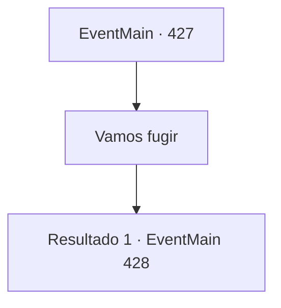

# Eventos principais · 427

[Índice da tabela](index.md) · [Índice geral](../index.md)

ID: `pt:EventMain:427` · Fonte: `EventMain4` · Versão: 1.2.47.

Mapeamento estático dos arquivos; a disponibilidade e a execução dependem do estado da run.

## Texto do evento

*Sem texto no arquivo.*

## Dados de entrada

```json
{
  "id": 427,
  "grade": 1,
  "normalGoal": "",
  "required": ""
}
```

## Mapa das escolhas



## Escolhas e resultados

### Escolha 1

Vamos fugir

Requisitos e outros campos da escolha:

```json
{
  "required": ""
}
```

#### Resultado 1.1

Depois de ouvir você, ela diz que pensou em um plano. 

 "Espera... Mesmo que nós fugíssemos, eu quero libertar todas essas pessoas. Se fugirmos juntos, teremos uma melhor chance de escapar."

 Depois de hesitar brevemente, Fiana sorri e continua. 

 "Ou então, podemos simplesmente nos livrar daquele que vai nos caçar pela dívida."


Continuação registrada: [Evento 428](0428.md) na mesma tabela.

```json
{
  "required": "",
  "chance": "1",
  "nextEvent": 428,
  "type": 2,
  "reward": ""
}
```

## Referências que chegam a este evento

- [Evento 426 · escolha 1 · resultado 1](0426.md#escolha-1)
- [Evento 426 · escolha 1 · resultado 2](0426.md#escolha-1)
- [Evento 426 · escolha 1 · resultado 3](0426.md#escolha-1)
- [Evento 426 · escolha 1 · resultado 4](0426.md#escolha-1)
- [Evento 426 · escolha 1 · resultado 5](0426.md#escolha-1)
- [Evento 426 · escolha 1 · resultado 6](0426.md#escolha-1)
