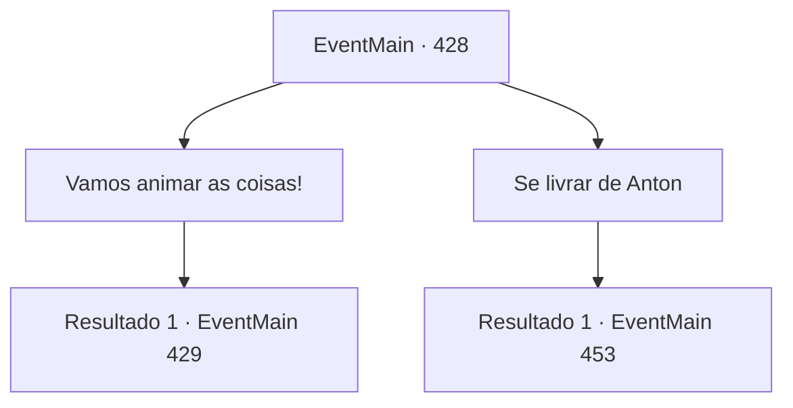

# Eventos principais · 428

[Índice da tabela](index.md) · [Índice geral](../index.md)

ID: `pt:EventMain:428` · Fonte: `EventMain4` · Versão: 1.2.47.

Mapeamento estático dos arquivos; a disponibilidade e a execução dependem do estado da run.

## Texto do evento

*Sem texto no arquivo.*

## Dados de entrada

```json
{
  "id": 428,
  "grade": 1,
  "normalGoal": "",
  "required": ""
}
```

## Mapa das escolhas



## Escolhas e resultados

### Escolha 1

Vamos animar as coisas!

Requisitos e outros campos da escolha:

```json
{
  "required": ""
}
```

#### Resultado 1.1

Fiana acena com a cabeça e levanta-se. Ela então começa a abrir as portas de outras celas da prisão. As pessoas dentro das celas saem de suas gaiolas, perplexas. Fiana grita para eles, incitando-os. 

 "Pessoas! Eu presumo que a maioria de vocês já tenha percebido, certo? Quanto mais tempo ficarmos aqui, maiores serão nossas dívidas! Vamos viver como brinquedos deles até a morte? OU VAMOS ENSINÁ-LOS UMA LIÇÃO?!"

 As pessoas começam a murmurar depois de ouvirem o discurso de Fiana. Então, os guardas aparecem e gritam. 

 "Voltem para suas celas imediatamente! Caso contrário, suas dívidas serão DOBRADAS!"

 Mas essa intimidação apenas salga as feridas. As pessoas enfurecidas começam a avançar contra os guardas e logo a prisão é preenchida com gritos ensanguentados. Todos os guardas acabam sendo vampiros. Com garras afiadas e presas, eles atacam impiedosamente os prisioneiros. Observando a cena se desenrolar, Fiana fala apressadamente com você. 

 "Nós... nós temos que lutar com eles...!"


Continuação registrada: [Evento 429](0429.md) na mesma tabela.

```json
{
  "required": "",
  "chance": "1",
  "nextEvent": 429,
  "type": 2,
  "reward": ""
}
```

### Escolha 2

Se livrar de Anton

Requisitos e outros campos da escolha:

```json
{
  "required": ""
}
```

#### Resultado 2.1

Você acha que é melhor se livrar da raiz de todos esses problemas. Fiana acena em resposta. 

 "O escritório de Anton deve estar nas partes mais profundas do porão. Nos livramos de Anton... e essa vida infernal também deverá acabar. Vamos lá."

 Então você desce para o porão mais profundo com Fiana. Após descer as escadas encharcadas até o porão, um longo corredor aparece diante de você. Apenas iluminado por tochas distantes, o corredor é adornado com uma variedade de esculturas e decorações. O chão é coberto por um longo tapete vermelho. No final do corredor há uma porta lindamente decorada com ouro e cobre, guardada por dois guardiões. O corredor tem um leve cheiro de sangue humano.

Continuação registrada: [Evento 453](0453.md) na mesma tabela.

```json
{
  "required": "",
  "chance": "1",
  "nextEvent": 453,
  "type": 2,
  "reward": ""
}
```

## Referências que chegam a este evento

- [Evento 427 · escolha 1 · resultado 1](0427.md#escolha-1)
