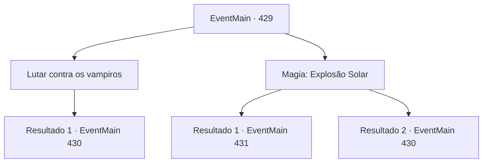

# Eventos principais · 429

[Índice da tabela](index.md) · [Índice geral](../index.md)

ID: `pt:EventMain:429` · Fonte: `EventMain4` · Versão: 1.2.47.

Mapeamento estático dos arquivos; a disponibilidade e a execução dependem do estado da run.

## Texto do evento

*Sem texto no arquivo.*

## Dados de entrada

```json
{
  "id": 429,
  "grade": 1,
  "normalGoal": "",
  "required": ""
}
```

## Mapa das escolhas



## Escolhas e resultados

### Escolha 1

Lutar contra os vampiros

Requisitos e outros campos da escolha:

```json
{
  "required": ""
}
```

#### Resultado 1.1

Você puxa sua arma e avança em direção aos vampiros. Fiana, também, pega uma estaca de madeira do chão.

Continuação registrada: [Evento 430](0430.md) na mesma tabela.

```json
{
  "required": "",
  "chance": "1",
  "nextEvent": 430,
  "type": 2,
  "reward": "6_0_19",
  "place": 7
}
```

### Escolha 2

Magia: Explosão Solar

Requisitos e outros campos da escolha:

```json
{
  "required": "20_0_4|1_1_2"
}
```

#### Resultado 2.1

No meio de todo o caos, você consegue se concentrar e lançar um feitiço que imita a luz do sol. Uma explosão de luz brilhante sai do seu selo mágico. Os vampiros são transformados em pilhas de cinzas. Então, Anton aparece do nada, vê você e grita. <link=shake>

 "V-você..! Você não é grato ... !!"

</link> Ele empurra os humanos próximos e cobra em sua direção.

Continuação registrada: [Evento 431](0431.md) na mesma tabela.

```json
{
  "required": "",
  "chance": "1|0_14_1",
  "nextEvent": 431,
  "type": 0,
  "reward": "0_1_-1|6_2_125",
  "place": 7
}
```

#### Resultado 2.2

Você tenta lançar um feitiço para imitar a luz do sol, mas falha. Você decide encontrar uma solução alternativa. Você pega sua arma e carrega os vampiros. Fiana também pega um poste de madeira do chão.

Continuação registrada: [Evento 430](0430.md) na mesma tabela.

```json
{
  "required": "",
  "chance": "13",
  "nextEvent": 430,
  "type": 1,
  "reward": "6_0_19",
  "place": 7
}
```

## Referências que chegam a este evento

- [Evento 428 · escolha 1 · resultado 1](0428.md#escolha-1)
