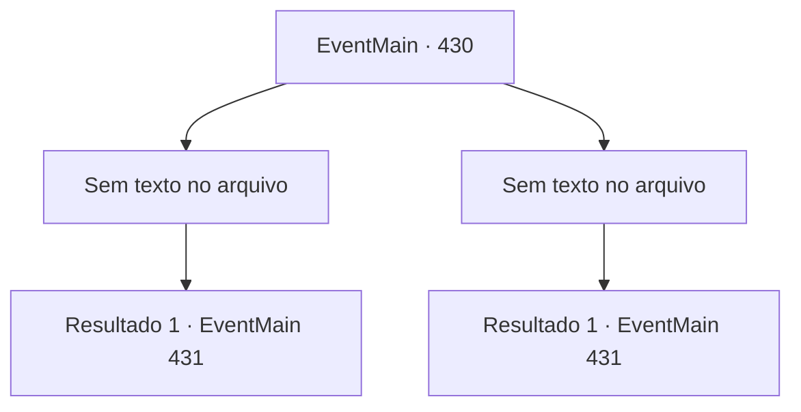

# Eventos principais · 430

[Índice da tabela](index.md) · [Índice geral](../index.md)

ID: `pt:EventMain:430` · Fonte: `EventMain4` · Versão: 1.2.47.

Mapeamento estático dos arquivos; a disponibilidade e a execução dependem do estado da run.

## Texto do evento

*Sem texto no arquivo.*

## Dados de entrada

```json
{
  "id": 430,
  "grade": 1,
  "normalGoal": "",
  "required": ""
}
```

## Mapa das escolhas



## Escolhas e resultados

### Escolha 1

*Sem texto no arquivo; o papel dessa opção depende da interface do jogo.*

Requisitos e outros campos da escolha:

```json
{
  "required": ""
}
```

#### Resultado 1.1

Depois de uma batalha feita, você derrota os vampiros. Então, Anton aparece do nada, vê você e grita. <link=shake> 

 "V-você..! Você não é grato...!!"

</link> Ele empurra os humanos próximos e cobra em sua direção.

Continuação registrada: [Evento 431](0431.md) na mesma tabela.

```json
{
  "required": "",
  "chance": "1",
  "nextEvent": 431,
  "type": 2,
  "reward": "6_0_125",
  "place": 7
}
```

### Escolha 2

*Sem texto no arquivo; o papel dessa opção depende da interface do jogo.*

Requisitos e outros campos da escolha:

```json
{
  "required": ""
}
```

#### Resultado 2.1

Os vampiros são, como você esperava inimigos difíceis. Enquanto você está lentamente ficando sobrecarregado, Fiana perfura um dos vampiros com seu poste de madeira. Então, Anton aparece do nada, vê você e grita. <link=shake> 

 "V-você..! Você não é grato...!!"

</link> Ele empurra os humanos próximos e cobra em sua direção.

Continuação registrada: [Evento 431](0431.md) na mesma tabela.

```json
{
  "required": "",
  "chance": "1",
  "nextEvent": 431,
  "type": 2,
  "reward": "6_0_125",
  "place": 7
}
```

## Referências que chegam a este evento

- [Evento 429 · escolha 1 · resultado 1](0429.md#escolha-1)
- [Evento 429 · escolha 2 · resultado 2](0429.md#escolha-2)
