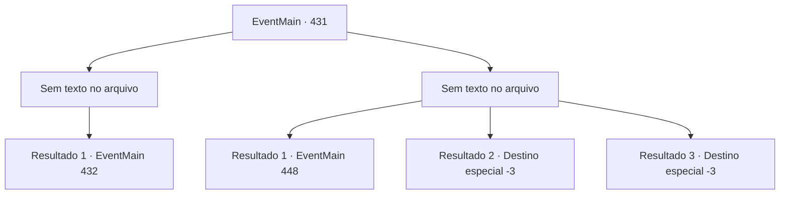

# Eventos principais · 431

[Índice da tabela](index.md) · [Índice geral](../index.md)

ID: `pt:EventMain:431` · Fonte: `EventMain4` · Versão: 1.2.47.

Mapeamento estático dos arquivos; a disponibilidade e a execução dependem do estado da run.

## Texto do evento

*Sem texto no arquivo.*

## Dados de entrada

```json
{
  "id": 431,
  "grade": 1,
  "normalGoal": "",
  "required": ""
}
```

## Mapa das escolhas



## Escolhas e resultados

### Escolha 1

*Sem texto no arquivo; o papel dessa opção depende da interface do jogo.*

Requisitos e outros campos da escolha:

```json
{
  "required": ""
}
```

#### Resultado 1.1

 

 "Ack..! Maldição..."

 Você vai atrás da cabeça de Anton. Ao ver isso, Anton rapidamente se transforma em uma companhia de morcegos e foge. Os outros vampiros também começam a fugir. Há algumas baixas, mas você consegue levar Fiana e os outros prisioneiros para fora do coliseu com sucesso. Todos mostram sua gratidão e fogem. Mas o rosto de Fiana ainda parece triste. 

 "Nós deveríamos ter matado o Anton... Ele vai voltar para se vingar, você sabe."

 Ela está preocupada que Anton voltará para retaliar.

Continuação registrada: [Evento 432](0432.md) na mesma tabela.

```json
{
  "required": "",
  "chance": "1",
  "nextEvent": 432,
  "type": 2,
  "reward": ""
}
```

### Escolha 2

*Sem texto no arquivo; o papel dessa opção depende da interface do jogo.*

Requisitos e outros campos da escolha:

```json
{
  "required": ""
}
```

#### Resultado 2.1

Anton aperta o aperto no pescoço. Você tenta se libertar dele, sem sucesso. Você consciência desaparece lentamente e desmaia. 

 Depois de algum tempo passou, você abre os olhos. Você olha em volta e descobre que está preso dentro de uma gaiola, construído com ligações de prata. Na sua frente, fica a Fiana, inconsciente. 

 "Você acorda?"

 Você olha depois de ouvir uma voz familiar. É Anton. Ele está deitado em um sofá de couro do lado de fora da gaiola, bebendo um copo de sangue. 

 "Você ... Deeeply, profundamente ... me decepcionou. Eu estava planejando apenas matá -lo e acabar com isso, mas depois tive uma ideia melhor."

 Ele diz para você se divertir, que é uma performance preparada especialmente para você. Anton estalou os dedos, e Fiana se levanta de maneira grotesca. |drawing_spawnFiana|

Continuação registrada: [Evento 448](0448.md) na mesma tabela.

```json
{
  "required": "1_0_2|1_1_2",
  "chance": "1",
  "nextEvent": 448,
  "type": 2,
  "reward": "0_0_-1|0_1_-1"
}
```

#### Resultado 2.2

Você desmaia no chão encharcado da prisão subterrânea escura. Você apaga.

Continuação registrada: [Destino especial `-3`](../destinos-especiais.md).

```json
{
  "required": "2_0_2",
  "chance": "1",
  "nextEvent": -3,
  "type": 2,
  "reward": "0_0_-1|0_1_-1"
}
```

#### Resultado 2.3

Você desmaia no chão encharcado da prisão subterrânea escura. Você desmaia.

Continuação registrada: [Destino especial `-3`](../destinos-especiais.md).

```json
{
  "required": "2_1_2",
  "chance": "1",
  "nextEvent": -3,
  "type": 2,
  "reward": "0_0_-1|0_1_-1"
}
```

## Referências que chegam a este evento

- [Evento 429 · escolha 2 · resultado 1](0429.md#escolha-2)
- [Evento 430 · escolha 1 · resultado 1](0430.md#escolha-1)
- [Evento 430 · escolha 2 · resultado 1](0430.md#escolha-2)
