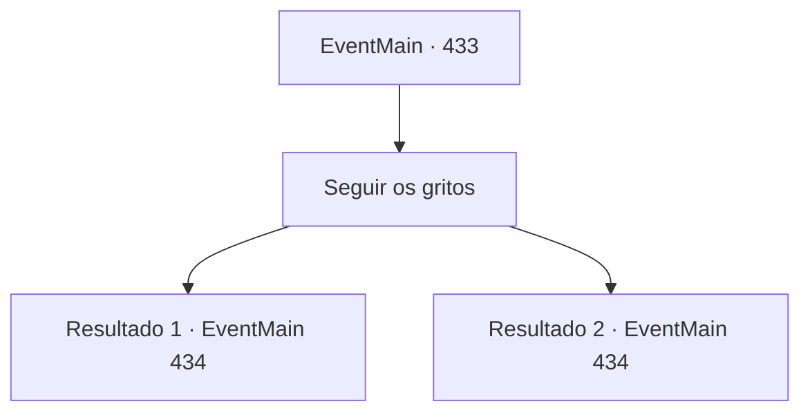

# Eventos principais · 433

[Índice da tabela](index.md) · [Índice geral](../index.md)

ID: `pt:EventMain:433` · Fonte: `EventMain4` · Versão: 1.2.47.

Mapeamento estático dos arquivos; a disponibilidade e a execução dependem do estado da run.

## Texto do evento

*Sem texto no arquivo.*

## Dados de entrada

```json
{
  "id": 433,
  "grade": 1,
  "normalGoal": "",
  "required": ""
}
```

## Mapa das escolhas



## Escolhas e resultados

### Escolha 1

Seguir os gritos

Requisitos e outros campos da escolha:

```json
{
  "required": ""
}
```

#### Resultado 1.1

Você segue as escadas para o subsolo mais profundo. Ao descer mais um andar, você chega a um corredor longo decorado com um tapete vermelho. Na extremidade esquerda do corredor há uma bela porta adornada com cobre e ouro. Na extremidade direita há outra escada, levando a um subsolo ainda mais profundo. Então, outro grito é ouvido. Os gritos, sem dúvida, estão vindo de Fiana. Está vindo da extremidade direita do corredor. Você se apressa rapidamente para a extremidade direita do corredor. Quanto mais você desce, mais claros os gritos ficam e mais escuro fica sua visão. Logo, está completamente escuro. Você não consegue ver um palmo à sua frente.

Continuação registrada: [Evento 434](0434.md) na mesma tabela.

```json
{
  "required": "18_281_3",
  "chance": "1",
  "nextEvent": 434,
  "type": 2,
  "reward": ""
}
```

#### Resultado 1.2

Você grita para as pessoas saírem e desce as escadas para o subsolo mais profundo. Ao descer mais um andar, você chega a um corredor longo decorado com um tapete vermelho. Na extremidade esquerda do corredor, há uma bela porta adornada com cobre e ouro. Na extremidade direita, há outra escada, levando a um subsolo ainda mais profundo. Então, outro grito é ouvido. Os gritos, sem dúvida, estão vindo de Fiana. Está vindo da extremidade direita do corredor. Você corre rapidamente para a extremidade direita do corredor. Quanto mais você desce, mais claros os gritos ficam e mais escuro fica sua visão. Logo, está completamente escuro. Você não consegue ver um palmo à sua frente.

Continuação registrada: [Evento 434](0434.md) na mesma tabela.

```json
{
  "required": "5_281_3",
  "chance": "1",
  "nextEvent": 434,
  "type": 2,
  "reward": ""
}
```

## Referências que chegam a este evento

- [Evento 422 · escolha 1 · resultado 3](0422.md#escolha-1)
- [Evento 423 · escolha 1 · resultado 2](0423.md#escolha-1)
- [Evento 424 · escolha 1 · resultado 1](0424.md#escolha-1)
- [Evento 424 · escolha 1 · resultado 4](0424.md#escolha-1)
- [Evento 425 · escolha 1 · resultado 2](0425.md#escolha-1)
