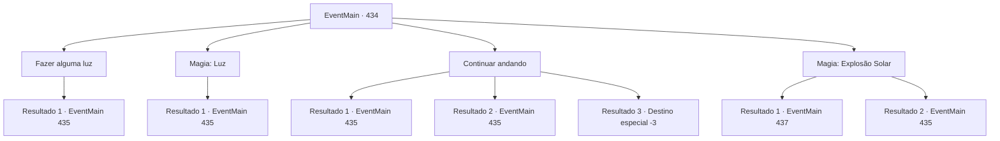

# Eventos principais · 434

[Índice da tabela](index.md) · [Índice geral](../index.md)

ID: `pt:EventMain:434` · Fonte: `EventMain4` · Versão: 1.2.47.

Mapeamento estático dos arquivos; a disponibilidade e a execução dependem do estado da run.

## Texto do evento

*Sem texto no arquivo.*

## Dados de entrada

```json
{
  "id": 434,
  "grade": 1,
  "normalGoal": "",
  "required": ""
}
```

## Mapa das escolhas



## Escolhas e resultados

### Escolha 1

Fazer alguma luz

Requisitos e outros campos da escolha:

```json
{
  "required": "23_3_1"
}
```

#### Resultado 1.1

Você acende um fogo. Em seguida, um vampiro avista a luz e corre em sua direção.

Continuação registrada: [Evento 435](0435.md) na mesma tabela.

```json
{
  "required": "",
  "chance": "1",
  "nextEvent": 435,
  "type": 2,
  "reward": "6_0_19",
  "place": 7
}
```

### Escolha 2

Magia: Luz

Requisitos e outros campos da escolha:

```json
{
  "required": "20_0_1"
}
```

#### Resultado 2.1

Você cria um fogo com magia. Em seguida, um vampiro avista a luz e avança em sua direção.

Continuação registrada: [Evento 435](0435.md) na mesma tabela.

```json
{
  "required": "",
  "chance": "1",
  "nextEvent": 435,
  "type": 2,
  "reward": "6_0_19",
  "place": 7
}
```

### Escolha 3

Continuar andando

Requisitos e outros campos da escolha:

```json
{
  "required": ""
}
```

#### Resultado 3.1

Você caminha para frente com confiança. Então, você encontra um par de olhos vermelhos brilhantes na escuridão. Um ataque vem das trevas, mas você consegue evitá-lo por pouco.

Continuação registrada: [Evento 435](0435.md) na mesma tabela.

```json
{
  "required": "",
  "chance": "1|0_6_1",
  "nextEvent": 435,
  "type": 0,
  "reward": "6_3_19",
  "place": 7
}
```

#### Resultado 3.2

Você caminha para frente com confiança. Então, você encontra um par de olhos vermelhos brilhantes na escuridão. Um ataque vem das sombras e te fere.

Continuação registrada: [Evento 435](0435.md) na mesma tabela.

```json
{
  "required": "1_0_2",
  "chance": "18",
  "nextEvent": 435,
  "type": 1,
  "reward": "6_3_19|0_0_-1",
  "place": 7
}
```

#### Resultado 3.3

Você caminha para frente com confiança. Então, você encontra um par de olhos vermelhos brilhantes na escuridão. Um ataque vem das sombras e te derruba no chão.

Continuação registrada: [Destino especial `-3`](../destinos-especiais.md).

```json
{
  "required": "2_0_2",
  "chance": "18",
  "nextEvent": -3,
  "type": 1,
  "reward": "0_0_-1"
}
```

### Escolha 4

Magia: Explosão Solar

Requisitos e outros campos da escolha:

```json
{
  "required": "20_0_4|1_1_2"
}
```

#### Resultado 4.1

O lugar é um covil de vampiros. Você lança um feitiço, apenas para se proteger. Como uma força magia é expelida da ponta dos seus dedos, o par de olhos vermelhos brilhantes queima de raiva. O vampiro fecha a distância num piscar de olhos, mas sua magia é mais rápida. O raio de sol criado por você transforma o vampiro em cinzas. Você limpa as cinzas com as mãos e segue em direção à porta, de onde vem os gritos.

Continuação registrada: [Evento 437](0437.md) na mesma tabela.

```json
{
  "required": "",
  "chance": "1|0_7_1|0_12_1",
  "nextEvent": 437,
  "type": 0,
  "reward": "0_1_-1"
}
```

#### Resultado 4.2

O lugar é um covil de vampiros. Você lança um feitiço, apenas para se proteger. Enquanto uma força magia é expelida da ponta dos seus dedos, o par de olhos vermelhos brilhantes queima de raiva. O vampiro fecha a distância num piscar de olhos. Decidindo que você não terá tempo suficiente para completar a magia, você alcança sua arma.

Continuação registrada: [Evento 435](0435.md) na mesma tabela.

```json
{
  "required": "",
  "chance": "20",
  "nextEvent": 435,
  "type": 1,
  "reward": "6_0_19|0_1_-1",
  "place": 7
}
```

## Referências que chegam a este evento

- [Evento 433 · escolha 1 · resultado 1](0433.md#escolha-1)
- [Evento 433 · escolha 1 · resultado 2](0433.md#escolha-1)
