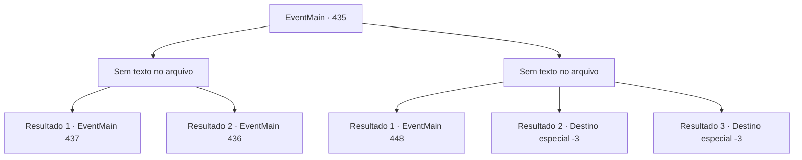

# Eventos principais · 435

[Índice da tabela](index.md) · [Índice geral](../index.md)

ID: `pt:EventMain:435` · Fonte: `EventMain4` · Versão: 1.2.47.

Mapeamento estático dos arquivos; a disponibilidade e a execução dependem do estado da run.

## Texto do evento

*Sem texto no arquivo.*

## Dados de entrada

```json
{
  "id": 435,
  "grade": 1,
  "normalGoal": "",
  "required": ""
}
```

## Mapa das escolhas



## Escolhas e resultados

### Escolha 1

*Sem texto no arquivo; o papel dessa opção depende da interface do jogo.*

Requisitos e outros campos da escolha:

```json
{
  "required": ""
}
```

#### Resultado 1.1

Você transforma o vampiro em cinzas e segue em direção à porta de onde vem os gritos. A porta está trancada, mas você consegue ver um raio de luz fraco vindo de dentro.

Continuação registrada: [Evento 437](0437.md) na mesma tabela.

```json
{
  "required": "23_2_1",
  "chance": "1",
  "nextEvent": 437,
  "type": 2,
  "reward": ""
}
```

#### Resultado 1.2

Você derrota o vampiro, mas ele se levanta e corre em sua direção.

Continuação registrada: [Evento 436](0436.md) na mesma tabela.

```json
{
  "required": "24_2_1",
  "chance": "1",
  "nextEvent": 436,
  "type": 2,
  "reward": "6_2_19",
  "place": 7
}
```

### Escolha 2

*Sem texto no arquivo; o papel dessa opção depende da interface do jogo.*

Requisitos e outros campos da escolha:

```json
{
  "required": ""
}
```

#### Resultado 2.1

Você é nocauteado inconsciente pelo vampiro. 

 Depois de algum tempo passou, você abre os olhos. Você olha em volta e descobre que está preso dentro de uma gaiola, construído com ligações de prata. Na sua frente, fica a Fiana, inconsciente. 

 "Você acorda?"

 Você olha depois de ouvir uma voz familiar. É Anton. Ele está deitado em um sofá de couro do lado de fora da gaiola, bebendo um copo de sangue. 

 "Você ... Deeeply, profundamente ... me decepcionou. Eu estava planejando apenas matá -lo e acabar com isso, mas depois tive uma ideia melhor."

 Ele diz para você se divertir, que é uma performance preparada especialmente para você. Anton estalou os dedos, e Fiana se levanta de maneira grotesca. |drawing_spawnFiana|

Continuação registrada: [Evento 448](0448.md) na mesma tabela.

```json
{
  "required": "1_0_2|1_1_2",
  "chance": "1",
  "nextEvent": 448,
  "type": 2,
  "reward": "0_0_-1|0_1_-1"
}
```

#### Resultado 2.2

O vampiro te acerta com uma força sobre-humana, e você cai, jorrando sangue.

Continuação registrada: [Destino especial `-3`](../destinos-especiais.md).

```json
{
  "required": "2_0_2",
  "chance": "1",
  "nextEvent": -3,
  "type": 2,
  "reward": "0_0_-1|0_1_-1"
}
```

#### Resultado 2.3

O vampiro te acerta com uma força sobre-humana, e você cai, jorrando sangue.

Continuação registrada: [Destino especial `-3`](../destinos-especiais.md).

```json
{
  "required": "2_1_2",
  "chance": "1",
  "nextEvent": -3,
  "type": 2,
  "reward": "0_0_-1|0_1_-1"
}
```

## Referências que chegam a este evento

- [Evento 434 · escolha 1 · resultado 1](0434.md#escolha-1)
- [Evento 434 · escolha 2 · resultado 1](0434.md#escolha-2)
- [Evento 434 · escolha 3 · resultado 1](0434.md#escolha-3)
- [Evento 434 · escolha 3 · resultado 2](0434.md#escolha-3)
- [Evento 434 · escolha 4 · resultado 2](0434.md#escolha-4)
