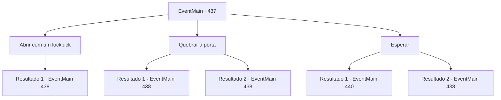

# Eventos principais · 437

[Índice da tabela](index.md) · [Índice geral](../index.md)

ID: `pt:EventMain:437` · Fonte: `EventMain4` · Versão: 1.2.47.

Mapeamento estático dos arquivos; a disponibilidade e a execução dependem do estado da run.

## Texto do evento

*Sem texto no arquivo.*

## Dados de entrada

```json
{
  "id": 437,
  "grade": 1,
  "normalGoal": "",
  "required": ""
}
```

## Mapa das escolhas



## Escolhas e resultados

### Escolha 1

Abrir com um lockpick

Requisitos e outros campos da escolha:

```json
{
  "required": "8_41_1"
}
```

#### Resultado 1.1

Você abre a porta com um pé de cabra. Dentro do quarto está Anton, segurando uma pequena pinça. Sua irmã está amarrada a uma pequena cadeira na frente. Seus olhos se voltam para Fiana. Seu corpo está coberto de hematomas e sangue escorre de suas mãos... Você percebe que algumas de suas unhas estão faltando. Anton te vê e te cumprimenta calmamente. 

 "Há quanto tempo, {1}. Como você tem passado? Que bom que você veio me encontrar primeiro. Eu ia te enviar as unhas dela como presente, mas agora não há mais necessidade de fazer isso!"


Continuação registrada: [Evento 438](0438.md) na mesma tabela.

```json
{
  "required": "",
  "chance": "1",
  "nextEvent": 438,
  "type": 2,
  "reward": ""
}
```

### Escolha 2

Quebrar a porta

Requisitos e outros campos da escolha:

```json
{
  "required": ""
}
```

#### Resultado 2.1

Você arromba a porta com seu poder. Dentro do quarto está Anton, segurando uma pequena pinça. Sua irmã está amarrada a uma cadeira pequena na frente. Seus olhos se voltam para Fiana. Seu corpo está coberto de hematomas e sangue escorre de suas mãos... Você percebe que algumas de suas unhas estão faltando. Anton te vê e te cumprimenta calmamente. 

 "Há quanto tempo, {1}. Como você tem passado? Que bom que você veio me encontrar primeiro. Eu ia te enviar as unhas dela como presente, mas agora não há mais necessidade de fazer isso!"


Continuação registrada: [Evento 438](0438.md) na mesma tabela.

```json
{
  "required": "",
  "chance": "1|0_5_1",
  "nextEvent": 438,
  "type": 0,
  "reward": ""
}
```

#### Resultado 2.2

Você bate na porta, mas a porta continua trancada. 

 "O quê...? Quem em sã consciência bateria assim?"

 A porta se abre e você encontra Anton, segurando uma pinça em suas mãos. Atrás dele está sua irmã Fiana, amarrada a uma cadeira. Seus olhos se voltam para ela. Seu corpo está coberto de hematomas e sangue escorre de suas mãos... Você percebe que algumas de suas unhas estão faltando. Anton te vê e te cumprimenta calmamente. 

 "Há quanto tempo, {1}. Como você tem passado? Que bom que você veio me encontrar primeiro. Eu ia te enviar as unhas dela como presente, mas agora não há mais necessidade de fazer isso!"


Continuação registrada: [Evento 438](0438.md) na mesma tabela.

```json
{
  "required": "",
  "chance": "13",
  "nextEvent": 438,
  "type": 1,
  "reward": ""
}
```

### Escolha 3

Esperar

Requisitos e outros campos da escolha:

```json
{
  "required": "1_1_2"
}
```

#### Resultado 3.1

<link=shake>

 "EU... EU VOU TE MATAR..!!! AAAAAHHHHHH!!"

</link> Você ainda pode ouvir gritos e maldições de Fiana e risada de Anton. Anton fala sarcasticamente. 

 "Culpe seu irmão idiota. Se ele não matasse meus lacaios, nada disso teria acontecido."

 Os gritos dolorosos de Fiana permanecem em seus ouvidos. Você tenta o seu melhor para suprimir sua raiva e se esconder atrás de um pilar próximo. Após cerca de dez minutos (que parecia uma hora), Anton abre a porta e sai do lado de fora. Ele então caminha pelo corredor e leva as escadas para cima.

Continuação registrada: [Evento 440](0440.md) na mesma tabela.

```json
{
  "required": "",
  "chance": "1|0_14_1",
  "nextEvent": 440,
  "type": 0,
  "reward": ""
}
```

#### Resultado 3.2

<link=shake>

 "EU... EU VOU TE MATAR..!!! AAAAAHHHHHH!!"

</link> Você ainda pode ouvir gritos e maldições de Fiana e risada de Anton. Anton fala sarcasticamente. 

 "Culpe seu irmão idiota. Se ele não matasse meus lacaios, nada disso teria acontecido."

 Ao ouvir seus gritos dolorosos, você se esconde atrás de um pilar próximo. Suas mãos tremem de ressentimento e seu coração parece que está sendo destruído. Incapaz de mantê -lo juntos, você bate na porta. 

 "O que...? Quem em sã consciência bate assim?"

 A porta se abre e você encontra Anton, segurando uma pinça nas mãos. Atrás dele está sua irmã Fiana, amarrada a uma cadeira. Seus olhos se voltam para ela. Seu corpo está coberto de hematomas e o sangue escorre de suas mãos ... você percebe que algumas das unhas dela estão faltando. Anton vê você e o cumprimenta calmamente. 

 "Muito tempo sem ver, {1}. Como você tem estado? Que gentileza da sua parte vir e me encontrar primeiro. Eu ia enviar -lhe suas figners como um presente, mas agora não há necessidade de fazer isso!"


Continuação registrada: [Evento 438](0438.md) na mesma tabela.

```json
{
  "required": "",
  "chance": "10",
  "nextEvent": 438,
  "type": 1,
  "reward": "0_1_-1"
}
```

## Referências que chegam a este evento

- [Evento 434 · escolha 4 · resultado 1](0434.md#escolha-4)
- [Evento 435 · escolha 1 · resultado 1](0435.md#escolha-1)
- [Evento 436 · escolha 1 · resultado 1](0436.md#escolha-1)
