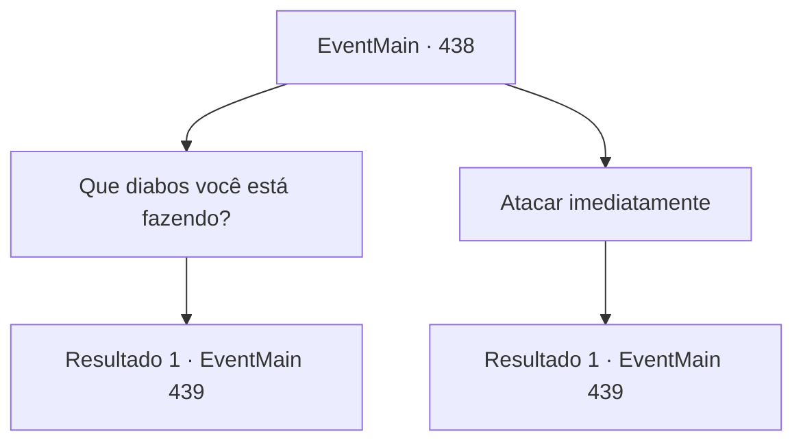

# Eventos principais · 438

[Índice da tabela](index.md) · [Índice geral](../index.md)

ID: `pt:EventMain:438` · Fonte: `EventMain4` · Versão: 1.2.47.

Mapeamento estático dos arquivos; a disponibilidade e a execução dependem do estado da run.

## Texto do evento

*Sem texto no arquivo.*

## Dados de entrada

```json
{
  "id": 438,
  "grade": 1,
  "normalGoal": "",
  "required": ""
}
```

## Mapa das escolhas



## Escolhas e resultados

### Escolha 1

Que diabos você está fazendo?

Requisitos e outros campos da escolha:

```json
{
  "required": ""
}
```

#### Resultado 1.1

Anton responde com um sorriso. 

 "Você não consegue ver? Sua irmã está sofrendo, como consequência de suas ações."

 Ele lambe o sangue das pinças e continua. 

 "*slurp*... Sério, você não precisava matar meus cobradores. Você apenas me empurra para os meus limites... Você deveria ser grato por eu não tê-la matado."

 Incapaz de aguentar mais, você corre em direção a ele.

Continuação registrada: [Evento 439](0439.md) na mesma tabela.

```json
{
  "required": "",
  "chance": "1",
  "nextEvent": 439,
  "type": 2,
  "reward": "6_0_125",
  "place": 7
}
```

### Escolha 2

Atacar imediatamente

Requisitos e outros campos da escolha:

```json
{
  "required": ""
}
```

#### Resultado 2.1

Você se apressa em Anton imediatamente, e ele aceita feliz o seu desafio.

Continuação registrada: [Evento 439](0439.md) na mesma tabela.

```json
{
  "required": "",
  "chance": "1",
  "nextEvent": 439,
  "type": 2,
  "reward": "6_0_125",
  "place": 7
}
```

## Referências que chegam a este evento

- [Evento 437 · escolha 1 · resultado 1](0437.md#escolha-1)
- [Evento 437 · escolha 2 · resultado 1](0437.md#escolha-2)
- [Evento 437 · escolha 2 · resultado 2](0437.md#escolha-2)
- [Evento 437 · escolha 3 · resultado 2](0437.md#escolha-3)
