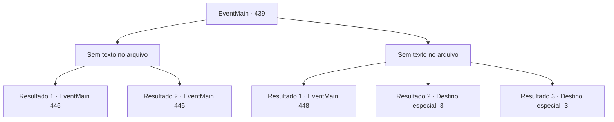

# Eventos principais · 439

[Índice da tabela](index.md) · [Índice geral](../index.md)

ID: `pt:EventMain:439` · Fonte: `EventMain4` · Versão: 1.2.47.

Mapeamento estático dos arquivos; a disponibilidade e a execução dependem do estado da run.

## Texto do evento

*Sem texto no arquivo.*

## Dados de entrada

```json
{
  "id": 439,
  "grade": 1,
  "normalGoal": "",
  "required": ""
}
```

## Mapa das escolhas



## Escolhas e resultados

### Escolha 1

*Sem texto no arquivo; o papel dessa opção depende da interface do jogo.*

Requisitos e outros campos da escolha:

```json
{
  "required": ""
}
```

#### Resultado 1.1

Você pega a cabeça de Anton e a bate em uma lareira próxima. Ele grita alto antes de se dissipar no ar. Você então desencadeia Fiana da cadeira. 

 "Obrigado ... irmão."|drawing_meetSis| Ela tenta o seu melhor para abraçá -lo com força com seu corpo ferido. Ela pede que você a siga, dizendo que há algo a fazer. Você segue Fiana pelo corredor vermelho. Vocês dois chegam ao outro extremo, bloqueados pela porta de Beaitly Decorated que viu há um tempo atrás. Fiana empurra a porta com toda a sua força, mas a porta não se mexe. 

 "Ugh ... nossos documentos devem estar aqui. Existe uma maneira de abrir a porta?"


Continuação registrada: [Evento 445](0445.md) na mesma tabela.

```json
{
  "required": "11_0_0",
  "chance": "1",
  "nextEvent": 445,
  "type": 2,
  "reward": "0_1_1"
}
```

#### Resultado 1.2

Você pega a cabeça de Anton e a bate em uma lareira próxima. Ele grita alto antes de se dissipar no ar. Você então desencadeia Fiana da cadeira. 

 "Obrigado ... irmã."|drawing_meetSis| Ela tenta o seu melhor para abraçá -lo com força com seu corpo ferido. Ela pede que você a siga, dizendo que há algo a fazer. Você segue Fiana pelo corredor vermelho. Vocês dois chegam ao outro extremo, bloqueados pela porta de Beaitly Decorated que viu há um tempo atrás. Fiana empurra a porta com toda a sua força, mas a porta não se mexe. 

 "Ugh ... nossos documentos devem estar aqui. Existe uma maneira de abrir a porta?"


Continuação registrada: [Evento 445](0445.md) na mesma tabela.

```json
{
  "required": "11_0_1",
  "chance": "1",
  "nextEvent": 445,
  "type": 2,
  "reward": "0_1_1"
}
```

### Escolha 2

*Sem texto no arquivo; o papel dessa opção depende da interface do jogo.*

Requisitos e outros campos da escolha:

```json
{
  "required": ""
}
```

#### Resultado 2.1

O soco de Anton cai em seu intestino. Você se ajoelha no chão e Anton termina você com um chute. 

 Depois de algum tempo passou, você abre os olhos. Você olha em volta e descobre que está preso dentro de uma gaiola, construído com ligações de prata. Na sua frente, fica a Fiana, inconsciente. 

 "Você acorda?"

 Você olha depois de ouvir uma voz familiar. É Anton. Ele está deitado em um sofá de couro do lado de fora da gaiola, bebendo um copo de sangue. 

 "Você ... Deeeply, profundamente ... me decepcionou. Eu estava planejando apenas matá -lo e acabar com isso, mas depois tive uma ideia melhor."

 Ele diz para você se divertir, que é uma performance preparada especialmente para você. Anton estalou os dedos, e Fiana se levanta de maneira grotesca. |drawing_spawnFiana|

Continuação registrada: [Evento 448](0448.md) na mesma tabela.

```json
{
  "required": "1_0_2|1_1_2",
  "chance": "1",
  "nextEvent": 448,
  "type": 2,
  "reward": "0_0_-1|0_1_-1"
}
```

#### Resultado 2.2

O soco de Anton te derruba. Você desaba no chão frio. 

 "N...Não...!!"

 Você ouve a voz rouca de Fiana, gritando. Com isso, você perde a consciência.

Continuação registrada: [Destino especial `-3`](../destinos-especiais.md).

```json
{
  "required": "2_0_2",
  "chance": "1",
  "nextEvent": -3,
  "type": 2,
  "reward": "0_0_-1|0_1_-1"
}
```

#### Resultado 2.3

O soco de Anton te derruba. Você desaba no chão frio. 

 "N...Não...!!"

 Você ouve a voz rouca de Fiana, gritando. Com isso, você perde a consciência.

Continuação registrada: [Destino especial `-3`](../destinos-especiais.md).

```json
{
  "required": "2_1_2",
  "chance": "1",
  "nextEvent": -3,
  "type": 2,
  "reward": "0_0_-1|0_1_-1"
}
```

## Referências que chegam a este evento

- [Evento 438 · escolha 1 · resultado 1](0438.md#escolha-1)
- [Evento 438 · escolha 2 · resultado 1](0438.md#escolha-2)
