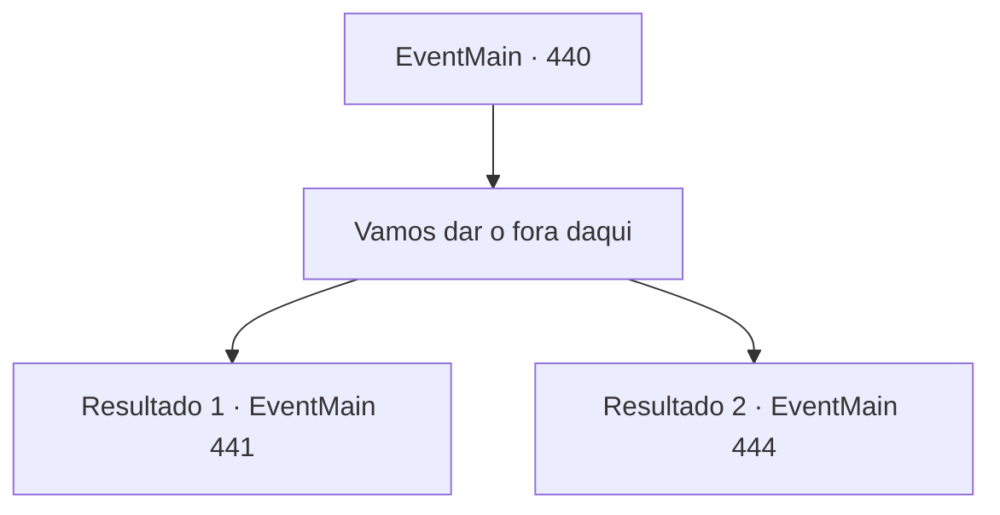

# Eventos principais · 440

[Índice da tabela](index.md) · [Índice geral](../index.md)

ID: `pt:EventMain:440` · Fonte: `EventMain4` · Versão: 1.2.47.

Mapeamento estático dos arquivos; a disponibilidade e a execução dependem do estado da run.

## Texto do evento

*Sem texto no arquivo.*

## Dados de entrada

```json
{
  "id": 440,
  "grade": 1,
  "normalGoal": "",
  "required": ""
}
```

## Mapa das escolhas



## Escolhas e resultados

### Escolha 1

Vamos dar o fora daqui

Requisitos e outros campos da escolha:

```json
{
  "required": ""
}
```

#### Resultado 1.1

Você ajuda Fiana a se levantar, tirando-a da câmara de tortura. Você volta atrás em seus passos. Passando pelo corredor escuro com o tapete, você chega à prisão subterrânea. Você encontra um vampiro no caminho. Ele tem um anel de chaves em sua cintura. Ele parece ser um dos guardiões desta prisão. O vampiro olha para você de forma suspeita e fala. 

 "Uh... Acho que nunca te vi antes. O que você está fazendo com 'o Esquilo'?"


Continuação registrada: [Evento 441](0441.md) na mesma tabela.

```json
{
  "required": "",
  "chance": "1",
  "nextEvent": 441,
  "type": 2,
  "reward": ""
}
```

#### Resultado 1.2

Você ajuda Fiana, tirando -a da câmara de tortura. Você rastreia seus passos. A escada escura, o corredor, a prisão subterrânea...
 Você sai com segurança do Coliseu e solta um suspiro de alívio. Mas Fiana ainda parece preocupada, enquanto fala. 

 "Anton ... aquele bastardo ainda vai nos caçar."


Continuação registrada: [Evento 444](0444.md) na mesma tabela.

```json
{
  "required": "",
  "chance": "1",
  "nextEvent": 444,
  "type": 2,
  "reward": ""
}
```

## Referências que chegam a este evento

- [Evento 437 · escolha 3 · resultado 1](0437.md#escolha-3)
