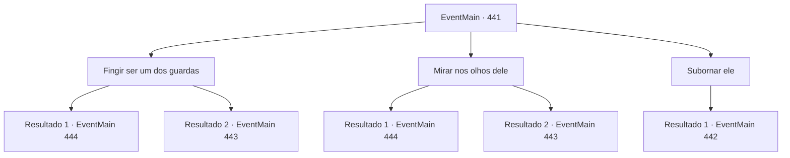

# Eventos principais · 441

[Índice da tabela](index.md) · [Índice geral](../index.md)

ID: `pt:EventMain:441` · Fonte: `EventMain4` · Versão: 1.2.47.

Mapeamento estático dos arquivos; a disponibilidade e a execução dependem do estado da run.

## Texto do evento

*Sem texto no arquivo.*

## Dados de entrada

```json
{
  "id": 441,
  "grade": 1,
  "normalGoal": "",
  "required": ""
}
```

## Mapa das escolhas



## Escolhas e resultados

### Escolha 1

Fingir ser um dos guardas

Requisitos e outros campos da escolha:

```json
{
  "required": ""
}
```

#### Resultado 1.1

Você diz a ele que 'o Esquilo' tentou escapar e que ela foi punida por isso. Você acrescenta que está levando-a de volta para a cela dela. O diretor não desconfia mais de você. Ele te encoraja pelo seu trabalho duro e passa por você. Você sai em segurança do coliseu e solta um suspiro de alívio. Mas Fiana ainda parece preocupada, enquanto ela fala. 

 "Anton... Aquele bastardo ainda vai nos caçar."


Continuação registrada: [Evento 444](0444.md) na mesma tabela.

```json
{
  "required": "",
  "chance": "1|0_12_1",
  "nextEvent": 444,
  "type": 0,
  "reward": ""
}
```

#### Resultado 1.2

Você diz a ele que 'o Esquilo' tentou escapar e que ela foi punida por isso. Você acrescenta que está colocando ela de volta em sua cela. Mas até uma criança pequena poderia ver através de sua atuação desajeitada. 

 "Você está tentando me enganar...!"

 Ele revela seus dentes e garras afiadas, se aproximando de você. Você empurra Fiana de lado e saca sua arma.

Continuação registrada: [Evento 443](0443.md) na mesma tabela.

```json
{
  "required": "",
  "chance": "11",
  "nextEvent": 443,
  "type": 1,
  "reward": "6_3_19",
  "place": 7
}
```

### Escolha 2

Mirar nos olhos dele

Requisitos e outros campos da escolha:

```json
{
  "required": ""
}
```

#### Resultado 2.1

Você rapidamente cutuca os olhos dele com os dedos. 

 "AACK...!!"

 Ele grita e cai escada abaixo. Ele não se move mais. Você sai em segurança do coliseu e solta um suspiro de alívio. Mas Fiana ainda parece preocupada, enquanto fala. 

 "Anton... Aquele bastardo ainda vai nos caçar"

.

Continuação registrada: [Evento 444](0444.md) na mesma tabela.

```json
{
  "required": "",
  "chance": "1|0_6_1",
  "nextEvent": 444,
  "type": 0,
  "reward": ""
}
```

#### Resultado 2.2

Você tenta rapidamente cutucar os olhos dele com os dedos, mas ele desvia. 

 "Você está tentando me enganar...!"

 Ele revela os dentes e garras afiadas, se aproximando de você. Você empurra Fiana para o lado e puxa sua arma.

Continuação registrada: [Evento 443](0443.md) na mesma tabela.

```json
{
  "required": "",
  "chance": "14",
  "nextEvent": 443,
  "type": 1,
  "reward": "6_3_19",
  "place": 7
}
```

### Escolha 3

Subornar ele

Requisitos e outros campos da escolha:

```json
{
  "required": ""
}
```

#### Resultado 3.1

Você diz a ele que está disposto a pagar pelo seu silêncio. Ele parece estar pensando nisso e responde. 

 "Hmph... 200 ouro. Pague-me isso e eu esquecerei disso."


Continuação registrada: [Evento 442](0442.md) na mesma tabela.

```json
{
  "required": "",
  "chance": "1",
  "nextEvent": 442,
  "type": 2,
  "reward": ""
}
```

## Referências que chegam a este evento

- [Evento 440 · escolha 1 · resultado 1](0440.md#escolha-1)
