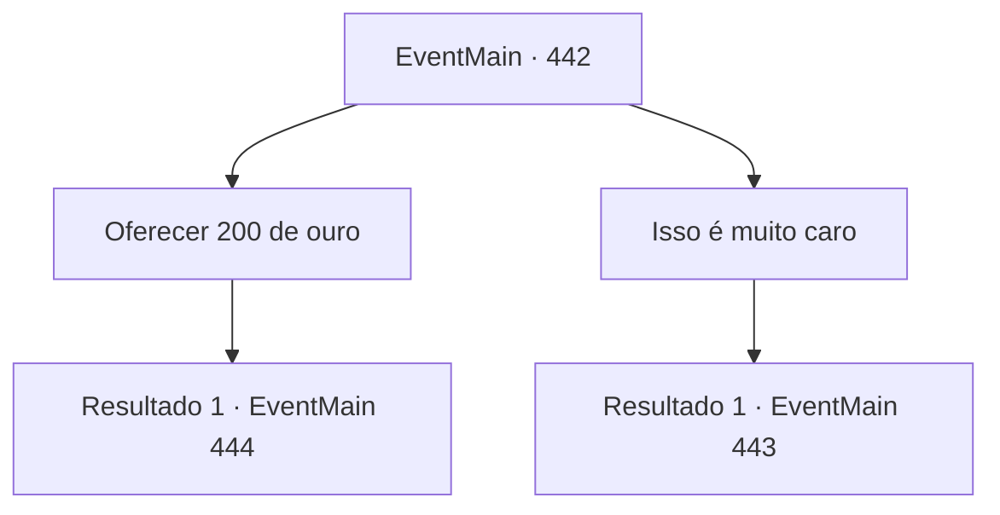

# Eventos principais · 442

[Índice da tabela](index.md) · [Índice geral](../index.md)

ID: `pt:EventMain:442` · Fonte: `EventMain4` · Versão: 1.2.47.

Mapeamento estático dos arquivos; a disponibilidade e a execução dependem do estado da run.

## Texto do evento

*Sem texto no arquivo.*

## Dados de entrada

```json
{
  "id": 442,
  "grade": 1,
  "normalGoal": "",
  "required": ""
}
```

## Mapa das escolhas



## Escolhas e resultados

### Escolha 1

Oferecer 200 de ouro

Requisitos e outros campos da escolha:

```json
{
  "required": "1_4_200"
}
```

#### Resultado 1.1

Depois de tirar o ouro de você, ele resmunga para si mesmo. 

 "Saiam daqui. Eu não vi nada."

 Você sai em segurança do coliseu e solta um suspiro de alívio. Mas Fiana ainda parece preocupada, enquanto ela fala. 

 "Anton... Aquele bastardo ainda vai nos caçar."


Continuação registrada: [Evento 444](0444.md) na mesma tabela.

```json
{
  "required": "",
  "chance": "1",
  "nextEvent": 444,
  "type": 2,
  "reward": "0_4_-200"
}
```

### Escolha 2

Isso é muito caro

Requisitos e outros campos da escolha:

```json
{
  "required": ""
}
```

#### Resultado 2.1

O vampiro diz que não haverá acordo então. Ele revela seus dentes e garras afiadas, se aproximando de você. Você empurra Fiana para o lado e saca sua arma.

Continuação registrada: [Evento 443](0443.md) na mesma tabela.

```json
{
  "required": "",
  "chance": "1",
  "nextEvent": 443,
  "type": 2,
  "reward": "6_3_19",
  "place": 7
}
```

## Referências que chegam a este evento

- [Evento 441 · escolha 3 · resultado 1](0441.md#escolha-3)
