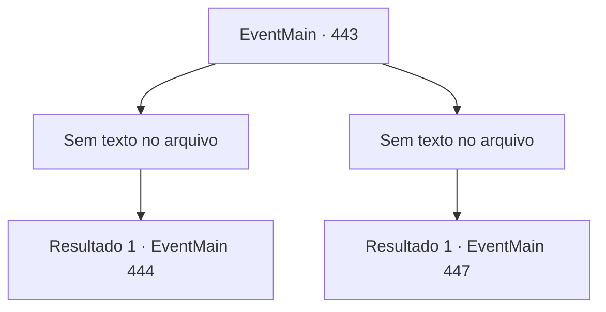

# Eventos principais · 443

[Índice da tabela](index.md) · [Índice geral](../index.md)

ID: `pt:EventMain:443` · Fonte: `EventMain4` · Versão: 1.2.47.

Mapeamento estático dos arquivos; a disponibilidade e a execução dependem do estado da run.

## Texto do evento

*Sem texto no arquivo.*

## Dados de entrada

```json
{
  "id": 443,
  "grade": 1,
  "normalGoal": "",
  "required": ""
}
```

## Mapa das escolhas



## Escolhas e resultados

### Escolha 1

*Sem texto no arquivo; o papel dessa opção depende da interface do jogo.*

Requisitos e outros campos da escolha:

```json
{
  "required": ""
}
```

#### Resultado 1.1

Você rapidamente cuida do vampiro e o joga dentro de uma cela vazia. Você ajuda Fiana a caminhar, escoltando-a para fora do coliseu. Então você solta um suspiro de alívio. Mas Fiana ainda parece preocupada, enquanto ela fala. 

 "Anton... Aquele bastardo ainda vai nos caçar."


Continuação registrada: [Evento 444](0444.md) na mesma tabela.

```json
{
  "required": "",
  "chance": "1",
  "nextEvent": 444,
  "type": 2,
  "reward": ""
}
```

### Escolha 2

*Sem texto no arquivo; o papel dessa opção depende da interface do jogo.*

Requisitos e outros campos da escolha:

```json
{
  "required": ""
}
```

#### Resultado 2.1

As garras do vampiro voam em sua direção. Mas então, Fiana corre e leva o golpe. 

 "Ah, pelo bem do FXCK .."

 O vampiro maldiza, tentando puxar suas garras da barriga de Fiana. Mas Fiana agarra o braço e o ombro do vampiro e depois se joga nas escadas.
 <link=shake>'THUMP! THUMP! THUMP!!'</link>
 O sangue cobre a escada e o vampiro se dissipa no ar como a névoa. Você corre para Fiana para verificar ela. Ela fala com você, respirando pesadamente. 

 "*Ufa*...*Ufa*... Deixe -me aqui ... e apenas ... vá ..."


Continuação registrada: [Evento 447](0447.md) na mesma tabela.

```json
{
  "required": "",
  "chance": "1",
  "nextEvent": 447,
  "type": 2,
  "reward": ""
}
```

## Referências que chegam a este evento

- [Evento 441 · escolha 1 · resultado 2](0441.md#escolha-1)
- [Evento 441 · escolha 2 · resultado 2](0441.md#escolha-2)
- [Evento 442 · escolha 2 · resultado 1](0442.md#escolha-2)
