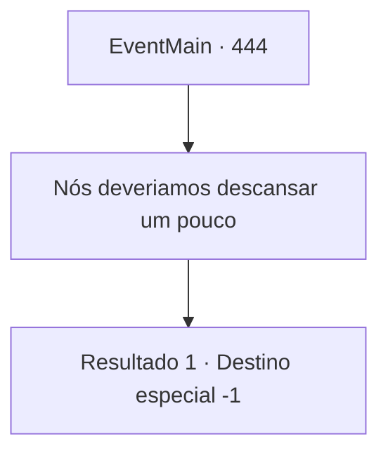

# Eventos principais · 444

[Índice da tabela](index.md) · [Índice geral](../index.md)

ID: `pt:EventMain:444` · Fonte: `EventMain4` · Versão: 1.2.47.

Mapeamento estático dos arquivos; a disponibilidade e a execução dependem do estado da run.

## Texto do evento

*Sem texto no arquivo.*

## Dados de entrada

```json
{
  "id": 444,
  "grade": 1,
  "normalGoal": "",
  "required": ""
}
```

## Mapa das escolhas



## Escolhas e resultados

### Escolha 1

Nós deveriamos descansar um pouco

Requisitos e outros campos da escolha:

```json
{
  "required": ""
}
```

#### Resultado 1.1

Você diz a Fiana que vocês dois devem se manter discretos e se esconder de Anton por um tempo. Ela solta um suspiro e responde. 

 "Sim. Acho que é assim que deve ser."

 Você e Fiana saem de Romb e vão para outra cidade.

Continuação registrada: [Destino especial `-1`](../destinos-especiais.md).

```json
{
  "required": "",
  "chance": "1",
  "nextEvent": -1,
  "type": 2,
  "reward": "15_4_9|0_2_1"
}
```

## Referências que chegam a este evento

- [Evento 440 · escolha 1 · resultado 2](0440.md#escolha-1)
- [Evento 441 · escolha 1 · resultado 1](0441.md#escolha-1)
- [Evento 441 · escolha 2 · resultado 1](0441.md#escolha-2)
- [Evento 442 · escolha 1 · resultado 1](0442.md#escolha-1)
- [Evento 443 · escolha 1 · resultado 1](0443.md#escolha-1)
- [Evento 456 · escolha 2 · resultado 1](0456.md#escolha-2)
