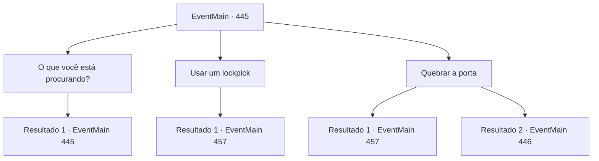

# Eventos principais · 445

[Índice da tabela](index.md) · [Índice geral](../index.md)

ID: `pt:EventMain:445` · Fonte: `EventMain4` · Versão: 1.2.47.

Mapeamento estático dos arquivos; a disponibilidade e a execução dependem do estado da run.

## Texto do evento

*Sem texto no arquivo.*

## Dados de entrada

```json
{
  "id": 445,
  "grade": 1,
  "normalGoal": "",
  "required": ""
}
```

## Mapa das escolhas



## Escolhas e resultados

### Escolha 1

O que você está procurando?

Requisitos e outros campos da escolha:

```json
{
  "required": "5_283_0"
}
```

#### Resultado 1.1

Você pergunta a Fiana o que tem dentro da porta, empurrando a porta juntos. 

 "Ugh... Isso não vai funcionar. Dentro deste escritório estão os documentos de todos que devem algo a Anton. Se nos livrarmos desses papéis... nos livramos de nossa dívida."


Continuação registrada: [Evento 445](0445.md) na mesma tabela.

```json
{
  "required": "",
  "chance": "1",
  "nextEvent": 445,
  "type": 2,
  "reward": "5_283_1"
}
```

### Escolha 2

Usar um lockpick

Requisitos e outros campos da escolha:

```json
{
  "required": "8_41_1"
}
```

#### Resultado 2.1

Você usa um bloqueio para adulterar a fechadura. O bloqueio quebra, mas felizmente a porta se abre. Dentro do que parece ser o escritório de Anton, há uma pequena lâmpada, algumas mesas, estantes de livros e documentos importantes. |drawing_antonRoom| Fiana imediatamente pega a lâmpada e atende fogo aos documentos. O fogo se espalha muito rapidamente, dos documentos à mesa, da mesa ao chão e do chão às paredes. Você e Fiana correram imediatamente do lado de fora do Coliseu. 

 "Está tudo acabado agora."


Continuação registrada: [Evento 457](0457.md) na mesma tabela.

```json
{
  "required": "",
  "chance": "1",
  "nextEvent": 457,
  "type": 2,
  "reward": "4_41_1|0_1_1"
}
```

### Escolha 3

Quebrar a porta

Requisitos e outros campos da escolha:

```json
{
  "required": ""
}
```

#### Resultado 3.1

Você esmaga a porta com sua força. Dentro do que parece ser o escritório de Anton, há uma pequena lâmpada, algumas mesas, estantes de livros e documentos importantes. |drawing_antonRoom| Fiana imediatamente pega a lâmpada e atende fogo aos documentos. O fogo se espalha muito rapidamente, dos documentos à mesa, da mesa ao chão e do chão às paredes. Você e Fiana correram imediatamente do lado de fora do Coliseu. 

 "Está tudo acabado agora."


Continuação registrada: [Evento 457](0457.md) na mesma tabela.

```json
{
  "required": "",
  "chance": "1|0_5_1",
  "nextEvent": 457,
  "type": 0,
  "reward": "0_1_1"
}
```

#### Resultado 3.2

Tentas arrombar a porta, mas ela não se mexe. Fiana sugere que investigues a área à tua volta.

Continuação registrada: [Evento 446](0446.md) na mesma tabela.

```json
{
  "required": "",
  "chance": "12",
  "nextEvent": 446,
  "type": 1,
  "reward": ""
}
```

## Referências que chegam a este evento

- [Evento 439 · escolha 1 · resultado 1](0439.md#escolha-1)
- [Evento 439 · escolha 1 · resultado 2](0439.md#escolha-1)
- [Evento 445 · escolha 1 · resultado 1](0445.md#escolha-1)
