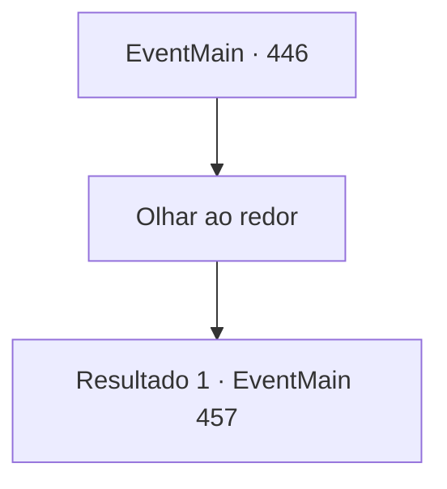

# Eventos principais · 446

[Índice da tabela](index.md) · [Índice geral](../index.md)

ID: `pt:EventMain:446` · Fonte: `EventMain4` · Versão: 1.2.47.

Mapeamento estático dos arquivos; a disponibilidade e a execução dependem do estado da run.

## Texto do evento

*Sem texto no arquivo.*

## Dados de entrada

```json
{
  "id": 446,
  "grade": 1,
  "normalGoal": "",
  "required": ""
}
```

## Mapa das escolhas



## Escolhas e resultados

### Escolha 1

Olhar ao redor

Requisitos e outros campos da escolha:

```json
{
  "required": ""
}
```

#### Resultado 1.1

Enquanto olha em volta, você encontra uma chave escondida sob um vaso de flores. A chave se encaixa perfeitamente na porta Beauitful. Dentro do que parece ser o escritório de Anton, há uma pequena lâmpada, algumas mesas, estantes de livros e documentos importantes. |drawing_antonRoom| Fiana imediatamente pega a lâmpada e atende fogo aos documentos. O fogo se espalha muito rapidamente, dos documentos à mesa, da mesa ao chão e do chão às paredes. Você e Fiana correram imediatamente do lado de fora do Coliseu. 

 "Está tudo acabado agora."


Continuação registrada: [Evento 457](0457.md) na mesma tabela.

```json
{
  "required": "",
  "chance": "1",
  "nextEvent": 457,
  "type": 0,
  "reward": "0_1_1"
}
```

## Referências que chegam a este evento

- [Evento 445 · escolha 3 · resultado 2](0445.md#escolha-3)
