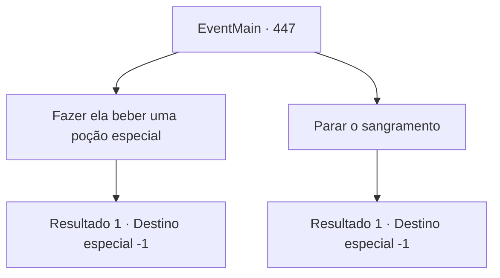

# Eventos principais · 447

[Índice da tabela](index.md) · [Índice geral](../index.md)

ID: `pt:EventMain:447` · Fonte: `EventMain4` · Versão: 1.2.47.

Mapeamento estático dos arquivos; a disponibilidade e a execução dependem do estado da run.

## Texto do evento

*Sem texto no arquivo.*

## Dados de entrada

```json
{
  "id": 447,
  "grade": 1,
  "normalGoal": "",
  "required": ""
}
```

## Mapa das escolhas



## Escolhas e resultados

### Escolha 1

Fazer ela beber uma poção especial

Requisitos e outros campos da escolha:

```json
{
  "required": "8_130_1"
}
```

#### Resultado 1.1

Você decide que os ferimentos de Fiana são muito graves. Uma poção comum não seria suficiente. Felizmente, você tinha uma poção especial em sua mochila. Você abre a tampa e despeja a poção na boca de Fiana. A respiração pesada de Fiana se acalma e ela adormece com uma expressão confortável. Você sai rapidamente do coliseu, carregando Fiana nas costas.

Continuação registrada: [Destino especial `-1`](../destinos-especiais.md).

```json
{
  "required": "",
  "chance": "1",
  "nextEvent": -1,
  "type": 2,
  "reward": "15_4_9|0_2_1|4_130_1"
}
```

### Escolha 2

Parar o sangramento

Requisitos e outros campos da escolha:

```json
{
  "required": ""
}
```

#### Resultado 2.1

Você rasga algumas de suas roupas para enfaixar o sangramento de Fiana. Mas seus ferimentos são muito graves. 

 "Apenas... vá..."

 Dizendo suas últimas palavras, a respiração de Fiana para. Você deixa o coliseu, carregando seu corpo sem vida nas costas.

Continuação registrada: [Destino especial `-1`](../destinos-especiais.md).

```json
{
  "required": "",
  "chance": "1",
  "nextEvent": -1,
  "type": 2,
  "reward": "15_4_16"
}
```

## Referências que chegam a este evento

- [Evento 443 · escolha 2 · resultado 1](0443.md#escolha-2)
