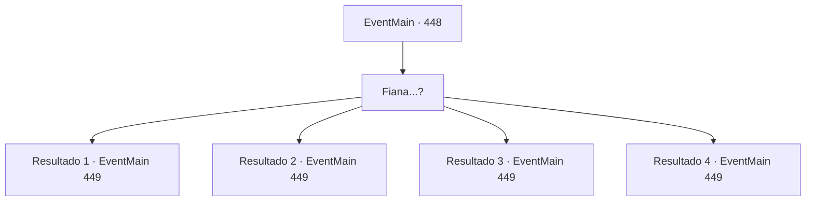

# Eventos principais · 448

[Índice da tabela](index.md) · [Índice geral](../index.md)

ID: `pt:EventMain:448` · Fonte: `EventMain4` · Versão: 1.2.47.

Mapeamento estático dos arquivos; a disponibilidade e a execução dependem do estado da run.

## Texto do evento

*Sem texto no arquivo.*

## Dados de entrada

```json
{
  "id": 448,
  "grade": 1,
  "normalGoal": "",
  "required": ""
}
```

## Mapa das escolhas



## Escolhas e resultados

### Escolha 1

Fiana...?

Requisitos e outros campos da escolha:

```json
{
  "required": ""
}
```

#### Resultado 1.1

Ela ouve sua voz e se vira para encarar você. Ela revela os dentes e começa a rosnar, correndo em sua direção. Você não tem escolha, a não ser lutar contra sua própria irmã.

Continuação registrada: [Evento 449](0449.md) na mesma tabela.

```json
{
  "required": "5_244_0",
  "chance": "1",
  "nextEvent": 449,
  "type": 2,
  "reward": "6_2_128",
  "place": 7
}
```

#### Resultado 1.2

Ela ouve sua voz e se vira para encarar você. Ela revela os dentes e começa a rosnar, correndo em sua direção. Você não tem escolha, a não ser lutar contra sua própria irmã.

Continuação registrada: [Evento 449](0449.md) na mesma tabela.

```json
{
  "required": "5_244_1",
  "chance": "1",
  "nextEvent": 449,
  "type": 2,
  "reward": "6_0_128",
  "place": 7
}
```

#### Resultado 1.3

Ela ouve sua voz e se vira para encarar você. Ela revela os dentes e começa a rosnar, correndo em sua direção. Você não tem escolha, a não ser lutar contra sua própria irmã.

Continuação registrada: [Evento 449](0449.md) na mesma tabela.

```json
{
  "required": "5_244_2",
  "chance": "1",
  "nextEvent": 449,
  "type": 2,
  "reward": "6_3_128",
  "place": 7
}
```

#### Resultado 1.4

Ela ouve sua voz e se vira para encarar você. Ela revela os dentes e começa a rosnar, correndo em sua direção. Você não tem escolha, a não ser lutar contra sua própria irmã.

Continuação registrada: [Evento 449](0449.md) na mesma tabela.

```json
{
  "required": "5_244_4",
  "chance": "1",
  "nextEvent": 449,
  "type": 2,
  "reward": "6_2_128",
  "place": 7
}
```

## Referências que chegam a este evento

- [Evento 425 · escolha 2 · resultado 1](0425.md#escolha-2)
- [Evento 431 · escolha 2 · resultado 1](0431.md#escolha-2)
- [Evento 435 · escolha 2 · resultado 1](0435.md#escolha-2)
- [Evento 436 · escolha 2 · resultado 1](0436.md#escolha-2)
- [Evento 439 · escolha 2 · resultado 1](0439.md#escolha-2)
- [Evento 454 · escolha 2 · resultado 1](0454.md#escolha-2)
