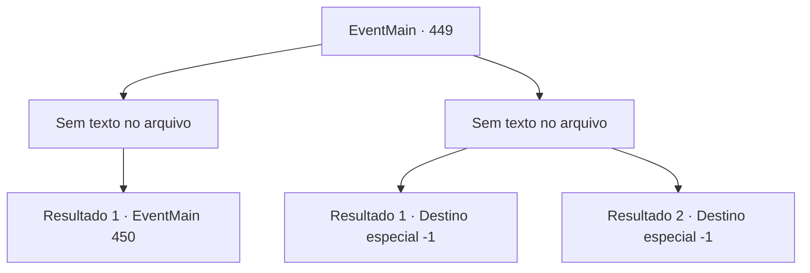

# Eventos principais · 449

[Índice da tabela](index.md) · [Índice geral](../index.md)

ID: `pt:EventMain:449` · Fonte: `EventMain4` · Versão: 1.2.47.

Mapeamento estático dos arquivos; a disponibilidade e a execução dependem do estado da run.

## Texto do evento

*Sem texto no arquivo.*

## Dados de entrada

```json
{
  "id": 449,
  "grade": 1,
  "normalGoal": "",
  "required": ""
}
```

## Mapa das escolhas



## Escolhas e resultados

### Escolha 1

*Sem texto no arquivo; o papel dessa opção depende da interface do jogo.*

Requisitos e outros campos da escolha:

```json
{
  "required": ""
}
```

#### Resultado 1.1

Você derruba Fiana, que se tornou uma criatura vampírica. Olhando para Fiana, contorcendo-se de dor no chão, Anton fala. 

 "Ai... Isso machuca seus sentimentos, lutar contra seu próprio irmão mais novo? Mas se você não a eliminar, eu farei. Então continue lutando."

 Assim que ele termina, Fiana tenta se levantar novamente.

Continuação registrada: [Evento 450](0450.md) na mesma tabela.

```json
{
  "required": "",
  "chance": "1",
  "nextEvent": 450,
  "type": 2,
  "reward": ""
}
```

### Escolha 2

*Sem texto no arquivo; o papel dessa opção depende da interface do jogo.*

Requisitos e outros campos da escolha:

```json
{
  "required": ""
}
```

#### Resultado 2.1

Você simplesmente não conseguiu matar sua irmãzinha, mesmo sendo uma criatura vampírica. Enquanto você hesita, os dentes de Fiana afundam em seu pescoço. Ela não é mais sua irmã, mas sim uma criatura sem mente sedenta por sangue. Você desmaia, com a risada de Anton enchendo seus ouvidos.

Continuação registrada: [Destino especial `-1`](../destinos-especiais.md).

```json
{
  "required": "24_1_1",
  "chance": "1",
  "nextEvent": -1,
  "type": 2,
  "reward": "0_0_-1|0_1_-1|15_4_21"
}
```

#### Resultado 2.2

Você simplesmente não conseguiu matar sua irmãzinha, mesmo sendo uma criatura vampírica. Enquanto você hesita, os dentes de Fiana afundam em seu pescoço. Ela não é mais sua irmã, mas sim uma criatura sem mente sedenta por sangue. Você desmaia, com a risada de Anton enchendo seus ouvidos.

Continuação registrada: [Destino especial `-1`](../destinos-especiais.md).

```json
{
  "required": "23_1_1",
  "chance": "1",
  "nextEvent": -1,
  "type": 2,
  "reward": "0_0_-1|0_1_-1|15_4_21|25_8_1"
}
```

## Referências que chegam a este evento

- [Evento 448 · escolha 1 · resultado 1](0448.md#escolha-1)
- [Evento 448 · escolha 1 · resultado 2](0448.md#escolha-1)
- [Evento 448 · escolha 1 · resultado 3](0448.md#escolha-1)
- [Evento 448 · escolha 1 · resultado 4](0448.md#escolha-1)
