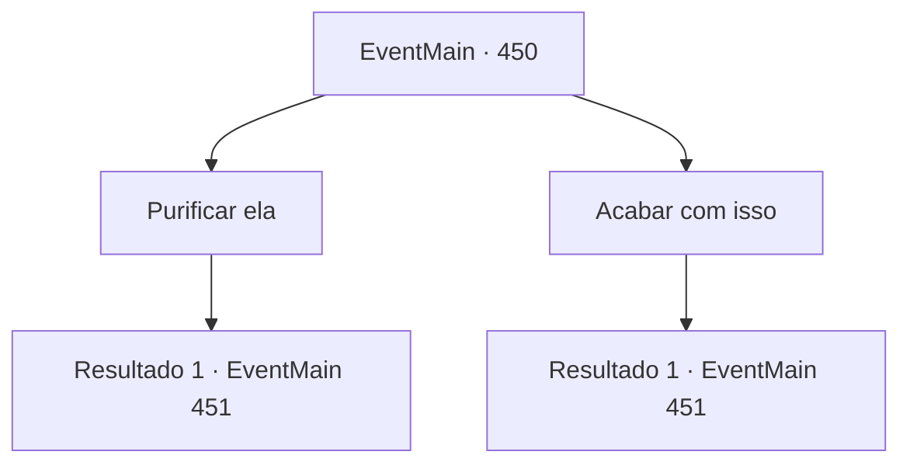

# Eventos principais · 450

[Índice da tabela](index.md) · [Índice geral](../index.md)

ID: `pt:EventMain:450` · Fonte: `EventMain4` · Versão: 1.2.47.

Mapeamento estático dos arquivos; a disponibilidade e a execução dependem do estado da run.

## Texto do evento

*Sem texto no arquivo.*

## Dados de entrada

```json
{
  "id": 450,
  "grade": 1,
  "normalGoal": "",
  "required": ""
}
```

## Mapa das escolhas



## Escolhas e resultados

### Escolha 1

Purificar ela

Requisitos e outros campos da escolha:

```json
{
  "required": "20_3_3"
}
```

#### Resultado 1.1

Você se aproxima de Fiana e infunde energia sagrada nela. Ela se contorce de dor, mas logo olha para você e fala. 

 "O...bri...ga...do..."

 Então ela fecha os olhos. Pelo menos ela morreu como um ser humano. Anton aplaude e fala. 

 "Ah, que comovente isso é. Uma pena que eu sou o único que pode testemunhar isso."

 Ele se aproxima lentamente da jaula e continua. 

 "Eu farei você sofrer o mesmo destino que ela. Muito em breve."

 Após terminar, Anton vira as costas para você.

Continuação registrada: [Evento 451](0451.md) na mesma tabela.

```json
{
  "required": "",
  "chance": "1",
  "nextEvent": 451,
  "type": 2,
  "reward": ""
}
```

### Escolha 2

Acabar com isso

Requisitos e outros campos da escolha:

```json
{
  "required": ""
}
```

#### Resultado 2.1

Você não tem mais escolha. Com suas próprias mãos, você pôs fim à vida de algo que costumava ser sua irmãzinha. Anton aplaude e fala. 

 "Muito divertido. Uma pena que sou o único que pode testemunhar sua luta."

 Ele se aproxima lentamente da gaiola e continua. 

 "Eu farei você sofrer o mesmo destino que ela. Muito em breve."

 Após terminar, Anton vira as costas para você.

Continuação registrada: [Evento 451](0451.md) na mesma tabela.

```json
{
  "required": "",
  "chance": "1",
  "nextEvent": 451,
  "type": 2,
  "reward": ""
}
```

## Referências que chegam a este evento

- [Evento 449 · escolha 1 · resultado 1](0449.md#escolha-1)
