# Eventos principais · 451

[Índice da tabela](index.md) · [Índice geral](../index.md)

ID: `pt:EventMain:451` · Fonte: `EventMain4` · Versão: 1.2.47.

Mapeamento estático dos arquivos; a disponibilidade e a execução dependem do estado da run.

## Texto do evento

*Sem texto no arquivo.*

## Dados de entrada

```json
{
  "id": 451,
  "grade": 1,
  "normalGoal": "",
  "required": ""
}
```

## Mapa das escolhas

```mermaid
flowchart TD
  E["EventMain · 451"]
  C0["Quebrar a gaiola"]
  E --> C0
  R0_0["Resultado 1 · EventMain 452"]
  C0 --> R0_0
  R0_1["Resultado 2 · Destino especial -1"]
  C0 --> R0_1
  R0_2["Resultado 3 · Destino especial -1"]
  C0 --> R0_2
  C1["Magia: Raio Solar"]
  E --> C1
  R1_0["Resultado 1 · Destino especial -1"]
  C1 --> R1_0
  R1_1["Resultado 2 · Destino especial -1"]
  C1 --> R1_1
  R1_2["Resultado 3 · Destino especial -1"]
  C1 --> R1_2
  R1_3["Resultado 4 · Destino especial -1"]
  C1 --> R1_3
  R1_4["Resultado 5 · Destino especial -1"]
  C1 --> R1_4
  R1_5["Resultado 6 · Destino especial -1"]
  C1 --> R1_5
  R1_6["Resultado 7 · Destino especial -1"]
  C1 --> R1_6
  R1_7["Resultado 8 · Destino especial -1"]
  C1 --> R1_7
  R1_8["Resultado 9 · Destino especial -1"]
  C1 --> R1_8
  R1_9["Resultado 10 · Destino especial -1"]
  C1 --> R1_9
```



## Escolhas e resultados

### Escolha 1

Quebrar a gaiola

Requisitos e outros campos da escolha:

```json
{
  "required": ""
}
```

#### Resultado 1.1

Enfurecido, você agarra a gaiola de aço e a puxa aberta. Você então avança em direção a Anton imediatamente. 

 "Huh..?! Como você...!"

 Anton parece surpreso, mas logo se prepara para lutar.

Continuação registrada: [Evento 452](0452.md) na mesma tabela.

```json
{
  "required": "",
  "chance": "1|0_5_1",
  "nextEvent": 452,
  "type": 0,
  "reward": "6_0_125",
  "place": 7
}
```

#### Resultado 1.2

Enfurecido, você tenta rasgar um buraco na gaiola. Mas você não é forte o suficiente para fazer isso. Anton ri e sai. Você é deixado sozinho dentro da gaiola. 

 Alguns dias passam, e você sucumbiu à fome. A última coisa que você vê antes de fechar os olhos é a forma de Anton se aproximando de você. Mas você não conseguiu mover um dedo.

Continuação registrada: [Destino especial `-1`](../destinos-especiais.md).

```json
{
  "required": "24_1_1",
  "chance": "12",
  "nextEvent": -1,
  "type": 1,
  "reward": "15_4_1"
}
```

#### Resultado 1.3

Enfurecido, você tenta rasgar um buraco na gaiola. Mas você não é forte o suficiente para fazer isso. Anton ri e sai. Você é deixado sozinho dentro da gaiola. 

 Alguns dias passam, e você sucumbiu à fome. A última coisa que você vê antes de fechar os olhos é a forma de Anton se aproximando de você. Mas você não conseguiu mover um dedo.

Continuação registrada: [Destino especial `-1`](../destinos-especiais.md).

```json
{
  "required": "23_1_1",
  "chance": "12",
  "nextEvent": -1,
  "type": 1,
  "reward": "15_4_1|25_8_1"
}
```

### Escolha 2

Magia: Raio Solar

Requisitos e outros campos da escolha:

```json
{
  "required": "20_0_3|1_1_2"
}
```

#### Resultado 2.1

Você tenta lançar um feitiço para matar Anton de uma vez por todas, mas de alguma forma a energia magia apenas se dissipa no ar. Observando isso, Anton clica em sua língua e fala. 

 "Você realmente achou que não sou inteligente o suficiente para me preparar para isso? Vá em frente. Tentar."

 Anton ri e sai. Você é deixado sozinho dentro da gaiola. 

 Alguns dias passam, e você sucumbiu à fome. A última coisa que você vê antes de fechar os olhos é a forma de Anton se aproximando de você. Mas você não conseguiu mover um dedo.

Continuação registrada: [Destino especial `-1`](../destinos-especiais.md).

```json
{
  "required": "21_0_5|24_1_1",
  "chance": "1",
  "nextEvent": -1,
  "type": 2,
  "reward": "15_4_1"
}
```

#### Resultado 2.2

Você percebe que há um campo anti-magia lançado dentro da gaiola. Mas para você, isso não é um problema. Você distorce um pouco o campo anti-magia, para que sua área de efeito se torne o oposto. Então você dispara um raio de luz solar em direção a Anton. 

 "*cof cof*... ACK...! Como você...?"

 O raio de luz solar perfura o peito de Anton, e ele te encara com olhos ardendo de ódio. Seu corpo se transforma em cinzas. Você carrega o corpo morto de Fiana em suas costas, para dar a ela um enterro adequado em sua cidade natal.

Continuação registrada: [Destino especial `-1`](../destinos-especiais.md).

```json
{
  "required": "20_0_5",
  "chance": "1",
  "nextEvent": -1,
  "type": 2,
  "reward": "15_4_17|0_1_-1"
}
```

#### Resultado 2.3

Você tenta lançar um feitiço para matar Anton de uma vez por todas, mas de alguma forma a energia magia apenas se dissipa no ar. Observando isso, Anton clica em sua língua e fala. 

 "Você realmente achou que não sou inteligente o suficiente para me preparar para isso? Vá em frente. Tentar."

 Anton ri e sai. Você é deixado sozinho dentro da gaiola. 

 Alguns dias passam, e você sucumbiu à fome. A última coisa que você vê antes de fechar os olhos é a forma de Anton se aproximando de você. Mas você não conseguiu mover um dedo.

Continuação registrada: [Destino especial `-1`](../destinos-especiais.md).

```json
{
  "required": "21_0_5|31_0_7",
  "chance": "1",
  "nextEvent": -1,
  "type": 2,
  "reward": "15_4_1|29_0_7|14_0_8"
}
```

#### Resultado 2.4

Você tenta lançar um feitiço para matar Anton de uma vez por todas, mas de alguma forma a energia magia apenas se dissipa no ar. Observando isso, Anton clica em sua língua e fala. 

 "Você realmente achou que não sou inteligente o suficiente para me preparar para isso? Vá em frente. Tentar."

 Anton ri e sai. Você é deixado sozinho dentro da gaiola. 

 Alguns dias passam, e você sucumbiu à fome. A última coisa que você vê antes de fechar os olhos é a forma de Anton se aproximando de você. Mas você não conseguiu mover um dedo.

Continuação registrada: [Destino especial `-1`](../destinos-especiais.md).

```json
{
  "required": "21_0_5|31_5_5",
  "chance": "1",
  "nextEvent": -1,
  "type": 2,
  "reward": "15_4_1|29_5_5|14_5_11"
}
```

#### Resultado 2.5

Você tenta lançar um feitiço para matar Anton de uma vez por todas, mas de alguma forma a energia magia apenas se dissipa no ar. Observando isso, Anton clica em sua língua e fala. 

 "Você realmente achou que não sou inteligente o suficiente para me preparar para isso? Vá em frente. Tentar."

 Anton ri e sai. Você é deixado sozinho dentro da gaiola. 

 Alguns dias passam, e você sucumbiu à fome. A última coisa que você vê antes de fechar os olhos é a forma de Anton se aproximando de você. Mas você não conseguiu mover um dedo.

Continuação registrada: [Destino especial `-1`](../destinos-especiais.md).

```json
{
  "required": "21_0_5|31_5_7",
  "chance": "1",
  "nextEvent": -1,
  "type": 2,
  "reward": "15_4_1|29_5_7|14_5_10"
}
```

#### Resultado 2.6

Você tenta lançar um feitiço para matar Anton de uma vez por todas, mas de alguma forma a energia magia apenas se dissipa no ar. Observando isso, Anton clica em sua língua e fala. 

 "Você realmente achou que não sou inteligente o suficiente para me preparar para isso? Vá em frente. Tentar."

 Anton ri e sai. Você é deixado sozinho dentro da gaiola. 

 Alguns dias passam, e você sucumbiu à fome. A última coisa que você vê antes de fechar os olhos é a forma de Anton se aproximando de você. Mas você não conseguiu mover um dedo.

Continuação registrada: [Destino especial `-1`](../destinos-especiais.md).

```json
{
  "required": "21_0_5|31_5_8",
  "chance": "1",
  "nextEvent": -1,
  "type": 2,
  "reward": "15_4_1|29_5_8|14_5_10"
}
```

#### Resultado 2.7

Você tenta lançar um feitiço para matar Anton de uma vez por todas, mas de alguma forma a energia magia apenas se dissipa no ar. Observando isso, Anton clica em sua língua e fala. 

 "Você realmente achou que não sou inteligente o suficiente para me preparar para isso? Vá em frente. Tentar."

 Anton ri e sai. Você é deixado sozinho dentro da gaiola. 

 Alguns dias passam, e você sucumbiu à fome. A última coisa que você vê antes de fechar os olhos é a forma de Anton se aproximando de você. Mas você não conseguiu mover um dedo.

Continuação registrada: [Destino especial `-1`](../destinos-especiais.md).

```json
{
  "required": "21_0_5|31_7_9",
  "chance": "1",
  "nextEvent": -1,
  "type": 2,
  "reward": "15_4_1|29_7_9|14_7_13"
}
```

#### Resultado 2.8

Você tenta lançar um feitiço para matar Anton de uma vez por todas, mas de alguma forma a energia magia apenas se dissipa no ar. Observando isso, Anton clica em sua língua e fala. 

 "Você realmente achou que não sou inteligente o suficiente para me preparar para isso? Vá em frente. Tentar."

 Anton ri e sai. Você é deixado sozinho dentro da gaiola. 

 Alguns dias passam, e você sucumbiu à fome. A última coisa que você vê antes de fechar os olhos é a forma de Anton se aproximando de você. Mas você não conseguiu mover um dedo.

Continuação registrada: [Destino especial `-1`](../destinos-especiais.md).

```json
{
  "required": "21_0_5|31_9_2",
  "chance": "1",
  "nextEvent": -1,
  "type": 2,
  "reward": "15_4_1|29_9_2|14_9_15"
}
```

#### Resultado 2.9

Você tenta lançar um feitiço para matar Anton de uma vez por todas, mas de alguma forma a energia magia apenas se dissipa no ar. Observando isso, Anton clica em sua língua e fala. 

 "Você realmente achou que não sou inteligente o suficiente para me preparar para isso? Vá em frente. Tentar."

 Anton ri e sai. Você é deixado sozinho dentro da gaiola. 

 Alguns dias passam, e você sucumbiu à fome. A última coisa que você vê antes de fechar os olhos é a forma de Anton se aproximando de você. Mas você não conseguiu mover um dedo.

Continuação registrada: [Destino especial `-1`](../destinos-especiais.md).

```json
{
  "required": "21_0_5|31_9_4",
  "chance": "1",
  "nextEvent": -1,
  "type": 2,
  "reward": "15_4_1|29_9_4|14_9_15"
}
```

#### Resultado 2.10

Você tenta lançar um feitiço para matar Anton de uma vez por todas, mas de alguma forma a energia magia apenas se dissipa no ar. Observando isso, Anton clica em sua língua e fala. 

 "Você realmente achou que não sou inteligente o suficiente para me preparar para isso? Vá em frente. Tentar."

 Anton ri e sai. Você é deixado sozinho dentro da gaiola. 

 Alguns dias passam, e você sucumbiu à fome. A última coisa que você vê antes de fechar os olhos é a forma de Anton se aproximando de você. Mas você não conseguiu mover um dedo.

Continuação registrada: [Destino especial `-1`](../destinos-especiais.md).

```json
{
  "required": "21_0_5|31_9_6",
  "chance": "1",
  "nextEvent": -1,
  "type": 2,
  "reward": "15_4_1|29_9_6|14_9_16"
}
```

## Referências que chegam a este evento

- [Evento 450 · escolha 1 · resultado 1](0450.md#escolha-1)
- [Evento 450 · escolha 2 · resultado 1](0450.md#escolha-2)
