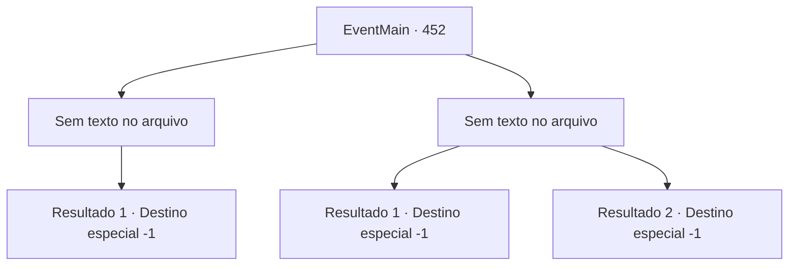

# Eventos principais · 452

[Índice da tabela](index.md) · [Índice geral](../index.md)

ID: `pt:EventMain:452` · Fonte: `EventMain4` · Versão: 1.2.47.

Mapeamento estático dos arquivos; a disponibilidade e a execução dependem do estado da run.

## Texto do evento

*Sem texto no arquivo.*

## Dados de entrada

```json
{
  "id": 452,
  "grade": 1,
  "normalGoal": "",
  "required": ""
}
```

## Mapa das escolhas



## Escolhas e resultados

### Escolha 1

*Sem texto no arquivo; o papel dessa opção depende da interface do jogo.*

Requisitos e outros campos da escolha:

```json
{
  "required": ""
}
```

#### Resultado 1.1

Você bate em Anton e perfura o peito dele com a parte quebrada da gaiola de prata. Ele te encara com olhos ardendo de ódio. 

 "*tosse*...ACK...! Como você...!"

 Seu corpo se transforma em cinzas. Você carrega o corpo morto de Fiana nas costas, para dar a ela um enterro adequado em sua cidade natal.

Continuação registrada: [Destino especial `-1`](../destinos-especiais.md).

```json
{
  "required": "",
  "chance": "1",
  "nextEvent": -1,
  "type": 2,
  "reward": "15_4_17"
}
```

### Escolha 2

*Sem texto no arquivo; o papel dessa opção depende da interface do jogo.*

Requisitos e outros campos da escolha:

```json
{
  "required": ""
}
```

#### Resultado 2.1

Você luta contra Anton com todas as suas forças, mas não é páreo para ele. Ele te sufoca, rindo. 

 "Hahaha... Eu ia fazer você sofrer um destino semelhante ao da sua irmã, mas parece que você simplesmente não podia esperar."

 Ele revela seus dentes afiados e morde seu pescoço, drenando seu sangue. Você perde a consciência.

Continuação registrada: [Destino especial `-1`](../destinos-especiais.md).

```json
{
  "required": "24_1_1",
  "chance": "1",
  "nextEvent": -1,
  "type": 2,
  "reward": "15_4_1"
}
```

#### Resultado 2.2

Você luta contra Anton com todas as suas forças, mas não é páreo para ele. Ele te sufoca, rindo. 

 "Hahaha... Eu ia fazer você sofrer um destino semelhante ao da sua irmã, mas parece que você simplesmente não podia esperar."

 Ele revela seus dentes afiados e morde seu pescoço, drenando seu sangue. Você perde a consciência.

Continuação registrada: [Destino especial `-1`](../destinos-especiais.md).

```json
{
  "required": "23_1_1",
  "chance": "1",
  "nextEvent": -1,
  "type": 2,
  "reward": "15_4_1|25_8_1"
}
```

## Referências que chegam a este evento

- [Evento 451 · escolha 1 · resultado 1](0451.md#escolha-1)
