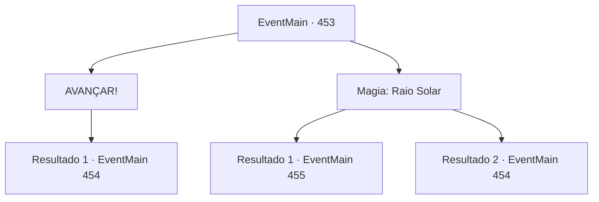

# Eventos principais · 453

[Índice da tabela](index.md) · [Índice geral](../index.md)

ID: `pt:EventMain:453` · Fonte: `EventMain4` · Versão: 1.2.47.

Mapeamento estático dos arquivos; a disponibilidade e a execução dependem do estado da run.

## Texto do evento

*Sem texto no arquivo.*

## Dados de entrada

```json
{
  "id": 453,
  "grade": 1,
  "normalGoal": "",
  "required": ""
}
```

## Mapa das escolhas



## Escolhas e resultados

### Escolha 1

AVANÇAR!

Requisitos e outros campos da escolha:

```json
{
  "required": ""
}
```

#### Resultado 1.1

Um corredor longo e estreito. Dois guardiões protegendo a porta. Você não vê outra solução senão lidar com eles. Você prepara sua arma e corre em direção aos guardiões. Fiana pega uma das espadas das decorações para te ajudar. Eles te avistam de longe e correm em sua direção, com suas presas expostas.

Continuação registrada: [Evento 454](0454.md) na mesma tabela.

```json
{
  "required": "",
  "chance": "1",
  "nextEvent": 454,
  "type": 2,
  "reward": "6_3_123",
  "place": 7
}
```

### Escolha 2

Magia: Raio Solar

Requisitos e outros campos da escolha:

```json
{
  "required": "20_0_3|1_1_2"
}
```

#### Resultado 2.1

Você lançou um feitiço para convocar os raios do sol. Um raio de luz solar explode no corredor. Os vampiros do guardião são transformados em cinzas sem sequer ter a chance de reagir. Você caminha orgulhosamente até a porta. A porta bem decorada é pesada, mas não está trancada. Dentro do que parece ser o escritório de Anton, há uma pequena lâmpada, algumas mesas, estantes de livros e documentos importantes. |drawing_antonRoom|

Continuação registrada: [Evento 455](0455.md) na mesma tabela.

```json
{
  "required": "",
  "chance": "1|0_7_1|0_12_1",
  "nextEvent": 455,
  "type": 0,
  "reward": "0_1_-1"
}
```

#### Resultado 2.2

Você lança um feitiço para convocar os raios do sol. Mas o feitiço não é lançado corretamente... Você percebe que a única opção restante é o combate. Você prepara sua arma e corre em direção aos guardiões do portão. Fiana pega uma das espadas das decorações para te ajudar.

Continuação registrada: [Evento 454](0454.md) na mesma tabela.

```json
{
  "required": "",
  "chance": "20",
  "nextEvent": 454,
  "type": 1,
  "reward": "6_3_123|0_1_-1",
  "place": 7
}
```

## Referências que chegam a este evento

- [Evento 428 · escolha 2 · resultado 1](0428.md#escolha-2)
