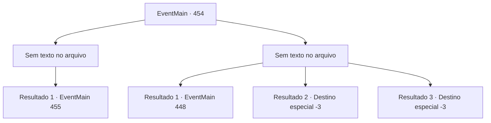

# Eventos principais · 454

[Índice da tabela](index.md) · [Índice geral](../index.md)

ID: `pt:EventMain:454` · Fonte: `EventMain4` · Versão: 1.2.47.

Mapeamento estático dos arquivos; a disponibilidade e a execução dependem do estado da run.

## Texto do evento

*Sem texto no arquivo.*

## Dados de entrada

```json
{
  "id": 454,
  "grade": 1,
  "normalGoal": "",
  "required": ""
}
```

## Mapa das escolhas



## Escolhas e resultados

### Escolha 1

*Sem texto no arquivo; o papel dessa opção depende da interface do jogo.*

Requisitos e outros campos da escolha:

```json
{
  "required": ""
}
```

#### Resultado 1.1

Os porteiros caem. Você abre a porta decorada. A porta é pesada, mas não está trancada. Dentro do que parece ser o escritório de Anton, há uma pequena lâmpada, algumas mesas, estantes de livros e documentos importantes. |drawing_antonRoom|

Continuação registrada: [Evento 455](0455.md) na mesma tabela.

```json
{
  "required": "",
  "chance": "1",
  "nextEvent": 455,
  "type": 2,
  "reward": ""
}
```

### Escolha 2

*Sem texto no arquivo; o papel dessa opção depende da interface do jogo.*

Requisitos e outros campos da escolha:

```json
{
  "required": ""
}
```

#### Resultado 2.1

Você é batido no chão pelos chutes dos vampiros. Os vampiros sufocam você com força desumana, e você desmaia. 

 Depois de algum tempo passou, você abre os olhos. Você olha em volta e descobre que está preso dentro de uma gaiola, construído com ligações de prata. Na sua frente, fica a Fiana, inconsciente. 

 "Você acorda?"

 Você olha depois de ouvir uma voz familiar. É Anton. Ele está deitado em um sofá de couro do lado de fora da gaiola, bebendo um copo de sangue. 

 "Você ... Deeeply, profundamente ... me decepcionou. Eu estava planejando apenas matá -lo e acabar com isso, mas depois tive uma ideia melhor."

 Ele diz para você se divertir, que é uma performance preparada especialmente para você. Anton estalou os dedos, e Fiana se levanta de maneira grotesca. |drawing_spawnFiana|

Continuação registrada: [Evento 448](0448.md) na mesma tabela.

```json
{
  "required": "1_0_2|1_1_2",
  "chance": "1",
  "nextEvent": 448,
  "type": 2,
  "reward": "0_0_-1|0_1_-1"
}
```

#### Resultado 2.2

Você é derrubado no chão pelos chutes dos vampiros. Os vampiros te sufocam com uma força sobre-humana, e você desmaia.

Continuação registrada: [Destino especial `-3`](../destinos-especiais.md).

```json
{
  "required": "2_0_2",
  "chance": "1",
  "nextEvent": -3,
  "type": 2,
  "reward": "0_0_-1|0_1_-1"
}
```

#### Resultado 2.3

Você é derrubado no chão pelos chutes dos vampiros. Os vampiros te sufocam com uma força sobre-humana, e você desmaia.

Continuação registrada: [Destino especial `-3`](../destinos-especiais.md).

```json
{
  "required": "2_1_2",
  "chance": "1",
  "nextEvent": -3,
  "type": 2,
  "reward": "0_0_-1|0_1_-1"
}
```

## Referências que chegam a este evento

- [Evento 453 · escolha 1 · resultado 1](0453.md#escolha-1)
- [Evento 453 · escolha 2 · resultado 2](0453.md#escolha-2)
