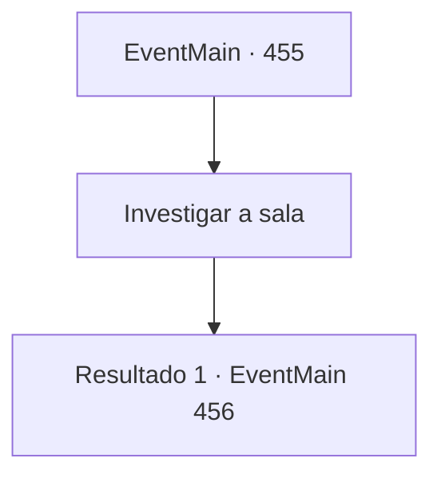

# Eventos principais · 455

[Índice da tabela](index.md) · [Índice geral](../index.md)

ID: `pt:EventMain:455` · Fonte: `EventMain4` · Versão: 1.2.47.

Mapeamento estático dos arquivos; a disponibilidade e a execução dependem do estado da run.

## Texto do evento

*Sem texto no arquivo.*

## Dados de entrada

```json
{
  "id": 455,
  "grade": 1,
  "normalGoal": "",
  "required": ""
}
```

## Mapa das escolhas



## Escolhas e resultados

### Escolha 1

Investigar a sala

Requisitos e outros campos da escolha:

```json
{
  "required": ""
}
```

#### Resultado 1.1

Você examina os documentos sobre a mesa. Nos documentos estão escritas as listas de pessoas que não puderam pagar a dívida e foram transformadas em gladiadores. Enquanto você está examinando os documentos, de repente a luz desaparece da sala, e a voz de Anton enche o ar. 

 "Ah... {1}. Eu nunca esperava que você me causasse tanta dor."

 Assim que você e Fiana ouvem a voz de Anton, os dois instintivamente alcançam suas armas. 

 "O bom senso dita que quando você pega algo emprestado, você deve devolver... E ainda assim você tenta tanto me matar, como se eu fosse o vilão. Mas... mas eu entendo você."

 Você não consegue vê-lo na escuridão, mas já consegue ver seu rosto, simbolizado por seu sorriso ganancioso. 

 "Então, você deve entender por que estou tentando matar vocês dois também. Certo?"

 Após terminar, Anton volta à sua forma física e avança em sua direção.

Continuação registrada: [Evento 456](0456.md) na mesma tabela.

```json
{
  "required": "",
  "chance": "1",
  "nextEvent": 456,
  "type": 2,
  "reward": "6_0_125",
  "place": 7
}
```

## Referências que chegam a este evento

- [Evento 453 · escolha 2 · resultado 1](0453.md#escolha-2)
- [Evento 454 · escolha 1 · resultado 1](0454.md#escolha-1)
