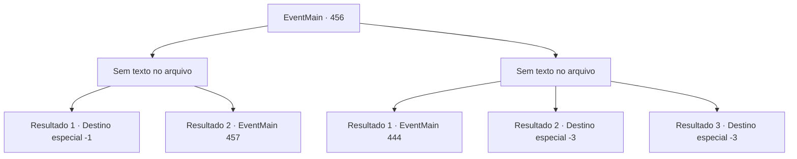

# Eventos principais · 456

[Índice da tabela](index.md) · [Índice geral](../index.md)

ID: `pt:EventMain:456` · Fonte: `EventMain4` · Versão: 1.2.47.

Mapeamento estático dos arquivos; a disponibilidade e a execução dependem do estado da run.

## Texto do evento

*Sem texto no arquivo.*

## Dados de entrada

```json
{
  "id": 456,
  "grade": 1,
  "normalGoal": "",
  "required": ""
}
```

## Mapa das escolhas



## Escolhas e resultados

### Escolha 1

*Sem texto no arquivo; o papel dessa opção depende da interface do jogo.*

Requisitos e outros campos da escolha:

```json
{
  "required": ""
}
```

#### Resultado 1.1


 "ACK...! Não.. isso não pode ser...!!"

 Ele estende as mãos para te agarrar, mas falha. Seu corpo se transforma em um monte de cinzas. Fiana imediatamente pega a lâmpada e incendeia os documentos. O fogo se espalha rapidamente, dos documentos para a mesa, da mesa para o chão e do chão para as paredes. Você e Fiana imediatamente correm para fora do coliseu. 

 "Acabou... tudo agora."


Continuação registrada: [Destino especial `-1`](../destinos-especiais.md).

```json
{
  "required": "23_2_1",
  "chance": "1",
  "nextEvent": -1,
  "type": 2,
  "reward": "15_4_2"
}
```

#### Resultado 1.2

Anton desmorona sob seus ataques. Mas acontece que o que realmente desmoronou não passava de armadura de Anton. Ele já mudou de névoa. Então, Fiana corre para uma parede próxima e pega a lâmpada. Ela então quebra no chão. O fogo se espalha para o tapete no chão e logo a sala é engolida por chamas. 

 "Aquele bastardo Anton ainda deveria estar aqui. Vamos sair daqui!"

 Você e Fiana saem da sala e fecham a porta. Você então puxa uma espada das decorações próximas e trava a porta com ela. 

 Logo, você e Fiana estão fora do Coliseu. Fiana solta um suspiro de alívio. 

 "Está tudo acabado agora."


Continuação registrada: [Evento 457](0457.md) na mesma tabela.

```json
{
  "required": "24_2_1",
  "chance": "1",
  "nextEvent": 457,
  "type": 2,
  "reward": ""
}
```

### Escolha 2

*Sem texto no arquivo; o papel dessa opção depende da interface do jogo.*

Requisitos e outros campos da escolha:

```json
{
  "required": ""
}
```

#### Resultado 2.1

Logo quando Anton está prestes a morder seu pescoço, Fiana grita. 

 "EI!! ANTON!!"

 Ela está cercada por chamas. Ela está segurando os documentos de Anton em suas mãos. Anton percebe o que ela está prestes a fazer e te empurra para longe. Ele então corre em direção a Fiana. Então, Fiana joga os papéis nas chamas. 

 "NÃO...!! NÃO!!!!"

 Enquanto Anton está ocupado recolhendo os documentos do fogo, você e Fiana correm para fora do coliseu. 

 "Sem dúvida ele vai voltar para se vingar."

 Ela mostra um profundo sinal de preocupação.

Continuação registrada: [Evento 444](0444.md) na mesma tabela.

```json
{
  "required": "1_0_2|1_1_2",
  "chance": "1",
  "nextEvent": 444,
  "type": 2,
  "reward": ""
}
```

#### Resultado 2.2

Anton mata você com um único golpe. Seu corpo fica frio e a última coisa que você ouve é o grito desesperado de Fiana.

Continuação registrada: [Destino especial `-3`](../destinos-especiais.md).

```json
{
  "required": "2_0_2",
  "chance": "1",
  "nextEvent": -3,
  "type": 2,
  "reward": "0_0_-1|0_1_-1"
}
```

#### Resultado 2.3

Anton mata você com um único golpe. Seu corpo fica frio, e a última coisa que você ouve é o grito desesperado de Fiana.

Continuação registrada: [Destino especial `-3`](../destinos-especiais.md).

```json
{
  "required": "2_1_2",
  "chance": "1",
  "nextEvent": -3,
  "type": 2,
  "reward": "0_0_-1|0_1_-1"
}
```

## Referências que chegam a este evento

- [Evento 455 · escolha 1 · resultado 1](0455.md#escolha-1)
