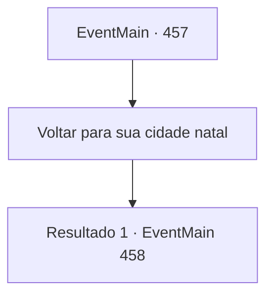

# Eventos principais · 457

[Índice da tabela](index.md) · [Índice geral](../index.md)

ID: `pt:EventMain:457` · Fonte: `EventMain4` · Versão: 1.2.47.

Mapeamento estático dos arquivos; a disponibilidade e a execução dependem do estado da run.

## Texto do evento

*Sem texto no arquivo.*

## Dados de entrada

```json
{
  "id": 457,
  "grade": 1,
  "normalGoal": "",
  "required": ""
}
```

## Mapa das escolhas



## Escolhas e resultados

### Escolha 1

Voltar para sua cidade natal

Requisitos e outros campos da escolha:

```json
{
  "required": ""
}
```

#### Resultado 1.1

|drawing_homeTown| Alguns dias depois, você volta para sua cidade natal com sua irmãzinha. Ela decide limpar a casa enquanto você faz as compras no mercado. Ao ir para o mercado da cidade, o sol se põe. Apesar do céu escurecer, o mercado só fica mais animado.

Continuação registrada: [Evento 458](0458.md) na mesma tabela.

```json
{
  "required": "",
  "chance": "1",
  "nextEvent": 458,
  "type": 2,
  "reward": ""
}
```

## Referências que chegam a este evento

- [Evento 445 · escolha 2 · resultado 1](0445.md#escolha-2)
- [Evento 445 · escolha 3 · resultado 1](0445.md#escolha-3)
- [Evento 446 · escolha 1 · resultado 1](0446.md#escolha-1)
- [Evento 456 · escolha 1 · resultado 2](0456.md#escolha-1)
