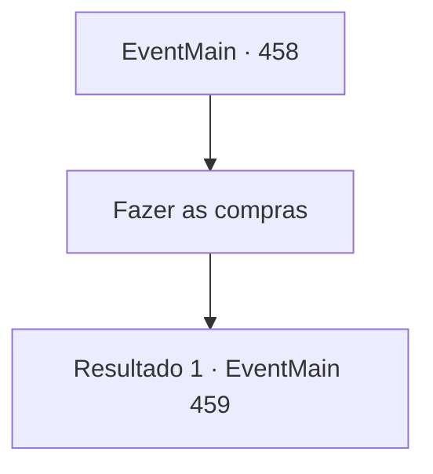

# Eventos principais · 458

[Índice da tabela](index.md) · [Índice geral](../index.md)

ID: `pt:EventMain:458` · Fonte: `EventMain4` · Versão: 1.2.47.

Mapeamento estático dos arquivos; a disponibilidade e a execução dependem do estado da run.

## Texto do evento

*Sem texto no arquivo.*

## Dados de entrada

```json
{
  "id": 458,
  "grade": 1,
  "normalGoal": "",
  "required": ""
}
```

## Mapa das escolhas



## Escolhas e resultados

### Escolha 1

Fazer as compras

Requisitos e outros campos da escolha:

```json
{
  "required": ""
}
```

#### Resultado 1.1

Enquanto você está prestes a voltar para casa depois de fazer as compras, alguns bandidos aparecem na sua frente. Suas roupas não diferem muito das de bandidos normais. Mas seus olhos são completamente brancos. 

 "....Grrrr..."

 O som que eles fazem se assemelha ao de uma fera em vez de um humano. Eles então avançam diretamente em sua direção.

Continuação registrada: [Evento 459](0459.md) na mesma tabela.

```json
{
  "required": "",
  "chance": "1",
  "nextEvent": 459,
  "type": 2,
  "reward": ""
}
```

## Referências que chegam a este evento

- [Evento 457 · escolha 1 · resultado 1](0457.md#escolha-1)
