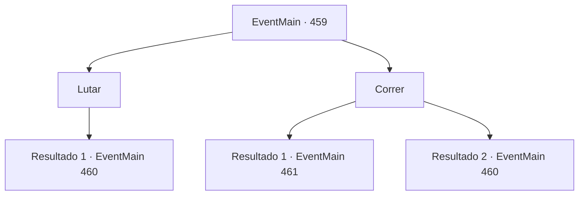

# Eventos principais · 459

[Índice da tabela](index.md) · [Índice geral](../index.md)

ID: `pt:EventMain:459` · Fonte: `EventMain4` · Versão: 1.2.47.

Mapeamento estático dos arquivos; a disponibilidade e a execução dependem do estado da run.

## Texto do evento

*Sem texto no arquivo.*

## Dados de entrada

```json
{
  "id": 459,
  "grade": 1,
  "normalGoal": "",
  "required": ""
}
```

## Mapa das escolhas



## Escolhas e resultados

### Escolha 1

Lutar

Requisitos e outros campos da escolha:

```json
{
  "required": ""
}
```

#### Resultado 1.1

Você decide dar a essas criaturas sem mente um descanso eterno.

Continuação registrada: [Evento 460](0460.md) na mesma tabela.

```json
{
  "required": "",
  "chance": "1",
  "nextEvent": 460,
  "type": 2,
  "reward": "6_3_129",
  "place": 4
}
```

### Escolha 2

Correr

Requisitos e outros campos da escolha:

```json
{
  "required": ""
}
```

#### Resultado 2.1

Você foge dos vampiros recém-nascidos. Eles são muito mais lentos do que você, então você facilmente ganha distância deles. Depois de fugir dos vampiros recém-nascidos, você volta rapidamente para sua casa. Então você percebe que algo está errado. Você abre rapidamente a porta e entra. As paredes têm buracos aqui e ali. Sangue cobre o piso de madeira. O sofrimento de sua irmã pode ser ouvido de um quarto. Anton espera por você na escuridão, sentado no sofá. 

 "Bem-vindo de volta. Você está atrasado... você me fez esperar."

 Ele se levanta, se aproxima de você e continua. 

 "Eu devo te ensinar o que acontece com um cachorro que desobedece seu mestre."

 Após terminar, Anton salta de sua cadeira e avança em você.

Continuação registrada: [Evento 461](0461.md) na mesma tabela.

```json
{
  "required": "",
  "chance": "1|0_6_1",
  "nextEvent": 461,
  "type": 0,
  "reward": "6_3_125",
  "place": 4
}
```

#### Resultado 2.2

Você foge dos vampiros recém-nascidos. Mas eles são mais rápidos do que você imaginava. Logo eles alcançam você.

Continuação registrada: [Evento 460](0460.md) na mesma tabela.

```json
{
  "required": "",
  "chance": "13",
  "nextEvent": 460,
  "type": 1,
  "reward": "6_3_129",
  "place": 4
}
```

## Referências que chegam a este evento

- [Evento 458 · escolha 1 · resultado 1](0458.md#escolha-1)
