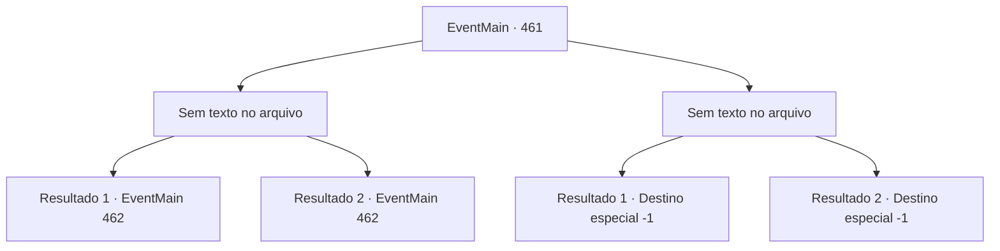

# Eventos principais · 461

[Índice da tabela](index.md) · [Índice geral](../index.md)

ID: `pt:EventMain:461` · Fonte: `EventMain4` · Versão: 1.2.47.

Mapeamento estático dos arquivos; a disponibilidade e a execução dependem do estado da run.

## Texto do evento

*Sem texto no arquivo.*

## Dados de entrada

```json
{
  "id": 461,
  "grade": 1,
  "normalGoal": "",
  "required": ""
}
```

## Mapa das escolhas



## Escolhas e resultados

### Escolha 1

*Sem texto no arquivo; o papel dessa opção depende da interface do jogo.*

Requisitos e outros campos da escolha:

```json
{
  "required": ""
}
```

#### Resultado 1.1

Anton irrompe em uma risada maligna, derrotado por você. 

 "Sua irmã... Ela não passa de um casulo agora. Em breve, ela perderá a si mesma e se transformará em um monstro..."

 Você separa a cabeça de Anton de seu corpo. Seu corpo queima em uma pilha de cinzas. Após derrotá-lo, você entra no quarto de sua irmã e encontra Fiana sofrendo em sua cama. Ela está suando sangue dolorosamente. Ela te vê e reúne todas as suas forças para falar com você. 

 "*soluço* Mate...m... me..."


Continuação registrada: [Evento 462](0462.md) na mesma tabela.

```json
{
  "required": "-1|23_2_1|20_3_4",
  "chance": "1",
  "nextEvent": 462,
  "type": 2,
  "reward": "5_278_1"
}
```

#### Resultado 1.2

Anton irrompe em uma risada maligna, derrotado por você. 

 "Sua irmã... Ela não passa de um casulo agora. Em breve, ela perderá a si mesma e se transformará em um monstro..."

 Você separa a cabeça de Anton de seu corpo. Seu corpo queima em uma pilha de cinzas. Após derrotá-lo, você entra no quarto de sua irmã e encontra Fiana sofrendo em sua cama. Ela está suando sangue dolorosamente. Ela te vê e reúne todas as suas forças para falar com você. 

 "*soluço* Mate...m... me..."


Continuação registrada: [Evento 462](0462.md) na mesma tabela.

```json
{
  "required": "24_2_1|21_3_4",
  "chance": "1",
  "nextEvent": 462,
  "type": 2,
  "reward": ""
}
```

### Escolha 2

*Sem texto no arquivo; o papel dessa opção depende da interface do jogo.*

Requisitos e outros campos da escolha:

```json
{
  "required": ""
}
```

#### Resultado 2.1

Anton derrota você e explode em uma risada maníaca. <link=shake>

 "Ahahahaha !!!"

</link> Ele amarra as mãos e os pés e depois joga você ao lado de Fiana, que parece estar passando por uma enorme quantidade de dor. Anton que diz que sua irmã logo se transformará em um monstro sedento de sangue. Como ele disse, Fiana para de se contorcer de dor e se levanta de maneira grotesca. Ela então cobra por você.

Continuação registrada: [Destino especial `-1`](../destinos-especiais.md).

```json
{
  "required": "24_1_1",
  "chance": "1",
  "nextEvent": -1,
  "type": 2,
  "reward": "15_4_21"
}
```

#### Resultado 2.2

Anton derrota você e explode em uma risada maníaca. <link=shake>

 "Ahahahaha !!!"

</link> Ele amarra as mãos e os pés e depois joga você ao lado de Fiana, que parece estar passando por uma enorme quantidade de dor. Anton que diz que sua irmã logo se transformará em um monstro sedento de sangue. Como ele disse, Fiana para de se contorcer de dor e se levanta de maneira grotesca. Ela então cobra por você.

Continuação registrada: [Destino especial `-1`](../destinos-especiais.md).

```json
{
  "required": "23_1_1",
  "chance": "1",
  "nextEvent": -1,
  "type": 2,
  "reward": "15_4_21|25_8_1"
}
```

## Referências que chegam a este evento

- [Evento 459 · escolha 2 · resultado 1](0459.md#escolha-2)
- [Evento 460 · escolha 1 · resultado 1](0460.md#escolha-1)
- [Evento 460 · escolha 2 · resultado 1](0460.md#escolha-2)
