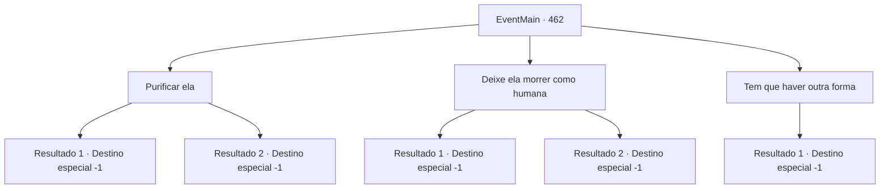

# Eventos principais · 462

[Índice da tabela](index.md) · [Índice geral](../index.md)

ID: `pt:EventMain:462` · Fonte: `EventMain4` · Versão: 1.2.47.

Mapeamento estático dos arquivos; a disponibilidade e a execução dependem do estado da run.

## Texto do evento

*Sem texto no arquivo.*

## Dados de entrada

```json
{
  "id": 462,
  "grade": 1,
  "normalGoal": "",
  "required": ""
}
```

## Mapa das escolhas



## Escolhas e resultados

### Escolha 1

Purificar ela

Requisitos e outros campos da escolha:

```json
{
  "required": "20_3_3"
}
```

#### Resultado 1.1

A transformação ainda não está completa. Você decide tentar purificar Fiana da maldição lançada sobre ela. Você reúne energia sagrada e a infunde nela, curando com sucesso a maldição de Anton. Ela ainda está sangrando. Seu corpo já passou por muito, mas ela ainda está viva. Você cuida dela dia e noite, para que ela possa se recuperar completamente.

Continuação registrada: [Destino especial `-1`](../destinos-especiais.md).

```json
{
  "required": "5_278_1",
  "chance": "1",
  "nextEvent": -1,
  "type": 2,
  "reward": "15_4_2"
}
```

#### Resultado 1.2

A transformação ainda não está completa. Você decide tentar purificar Fiana da maldição lançada sobre ela. Você reúne energia sagrada e a infunde nela, curando com sucesso a maldição de Anton. Ela ainda está sangrando. Seu corpo já passou por muito, mas ela ainda está viva. Você cuida dela dia e noite, para que ela possa se recuperar completamente.

Continuação registrada: [Destino especial `-1`](../destinos-especiais.md).

```json
{
  "required": "18_278_1",
  "chance": "1",
  "nextEvent": -1,
  "type": 2,
  "reward": "15_4_9"
}
```

### Escolha 2

Deixe ela morrer como humana

Requisitos e outros campos da escolha:

```json
{
  "required": ""
}
```

#### Resultado 2.1

Como ela pediu, você a ajuda a morrer como um ser humano digno. Você constantemente pensa para si mesmo que isso é o que você deve fazer, como sua família.

Continuação registrada: [Destino especial `-1`](../destinos-especiais.md).

```json
{
  "required": "5_278_1",
  "chance": "1",
  "nextEvent": -1,
  "type": 2,
  "reward": "15_4_17"
}
```

#### Resultado 2.2

Como ela pediu a você, você a ajuda a morrer como um ser humano adequado. Você constantemente pensa para si mesmo que isso é o que você deve fazer, como sua família.

Continuação registrada: [Destino especial `-1`](../destinos-especiais.md).

```json
{
  "required": "18_278_1",
  "chance": "1",
  "nextEvent": -1,
  "type": 2,
  "reward": "15_4_16"
}
```

### Escolha 3

Tem que haver outra forma

Requisitos e outros campos da escolha:

```json
{
  "required": ""
}
```

#### Resultado 3.1

Você recusa o pedido dela, amarrando suas mãos e pés e trancando-a no porão. Você decide encontrar uma maneira de quebrar a maldição.

Continuação registrada: [Destino especial `-1`](../destinos-especiais.md).

```json
{
  "required": "",
  "chance": "1",
  "nextEvent": -1,
  "type": 2,
  "reward": "15_4_18"
}
```

## Referências que chegam a este evento

- [Evento 461 · escolha 1 · resultado 1](0461.md#escolha-1)
- [Evento 461 · escolha 1 · resultado 2](0461.md#escolha-1)
