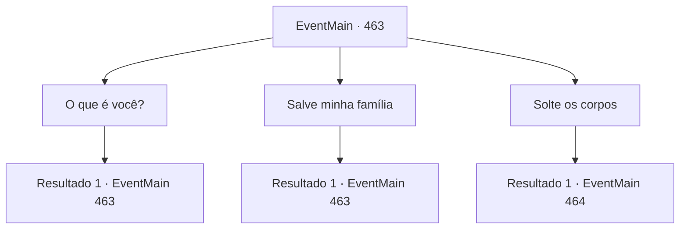

# Eventos principais · 463

[Índice da tabela](index.md) · [Índice geral](../index.md)

ID: `pt:EventMain:463` · Fonte: `EventMain4` · Versão: 1.2.47.

Mapeamento estático dos arquivos; a disponibilidade e a execução dependem do estado da run.

## Texto do evento

Você abre os olhos como se acordasse. Não há sinal do demônio que estendeu a mão. Você desce da estaca queimada e olha em volta com cuidado. Você vê dois corpos pendurados na estaca. Os corpos são sua família. Eles foram queimados na fogueira por um paladino chamado 'Onil' que servia a 'Tere'. Você pensa em Onil. Ele é um homem-lagarto com escamas amarelas e olhos rasgados verticalmente. 

 "É a ordem do arcebispo. Queime todos os adoradores de demônios."

 Ao comando dele, vários paladinos queimaram você e sua família. Você range os dentes e olha para os corpos carbonizados. Então, uma voz é ouvida novamente em sua cabeça. 

 "Eu tentei o meu melhor. Estou um pouco cansado."


## Dados de entrada

```json
{
  "id": 463,
  "grade": 1,
  "normalGoal": "",
  "required": "1_2_0|13_4_0"
}
```

## Mapa das escolhas



## Escolhas e resultados

### Escolha 1

O que é você?

Requisitos e outros campos da escolha:

```json
{
  "required": "5_350_0"
}
```

#### Resultado 1.1

Você pergunta ao dono da voz quem ele é. 

 "Eu sou Kior. Grão-Duque com a maior propriedade do inferno."

 Ele continua antes de você fazer outra pergunta. 

 "Fui gravemente ferido por Tere e perdi muitos dos meus homens e uma vasta propriedade. Então, eu realmente quero ajudá-lo a se vingar. Você pode confiar em mim."


Continuação registrada: [Evento 463](0463.md) na mesma tabela.

```json
{
  "required": "",
  "chance": "1",
  "nextEvent": 463,
  "type": 2,
  "reward": "5_350_1"
}
```

### Escolha 2

Salve minha família

Requisitos e outros campos da escolha:

```json
{
  "required": "5_350_1"
}
```

#### Resultado 2.1

Você implora à voz para salvar sua família. Então você ouve a voz em sua cabeça novamente. 

 "... Isso é impossível. Suas almas já foram para algum lugar onde eu não posso fazer nada."

 Nessa resposta decisiva, você tem que aceitar o fato de que deve deixar sua família ir embora.

Continuação registrada: [Evento 463](0463.md) na mesma tabela.

```json
{
  "required": "",
  "chance": "1",
  "nextEvent": 463,
  "type": 2,
  "reward": "5_350_2"
}
```

### Escolha 3

Solte os corpos

Requisitos e outros campos da escolha:

```json
{
  "required": "5_350_2"
}
```

#### Resultado 3.1

Depois de libertar sua esposa e filho, você pega seus corpos e segue para uma colina próxima. A escuridão da noite esconde sua figura.  Chegando ao pé da montanha, você cava o solo com as mãos suadas. Você chora muito.  O choro é porque você não suporta mais a raiva ardente do que a tristeza.  Você enterra os corpos de sua família por horas.  |drawing_familyTomb| Então, você sente a presença de alguém.  Quando você olha para trás, lá está o padre da aldeia, Jimmy.  Sempre sorrindo gentilmente, foi ele quem guiou os cavaleiros de Teresia até sua casa.  

 "De... Definitivamente... você, definitivamente... deveria estar morto..!"

  Ele murmura tolamente com um olhar atordoado.

Continuação registrada: [Evento 464](0464.md) na mesma tabela.

```json
{
  "required": "",
  "chance": "1",
  "nextEvent": 464,
  "type": 2,
  "reward": ""
}
```

## Referências que chegam a este evento

- [Evento 463 · escolha 1 · resultado 1](0463.md#escolha-1)
- [Evento 463 · escolha 2 · resultado 1](0463.md#escolha-2)
