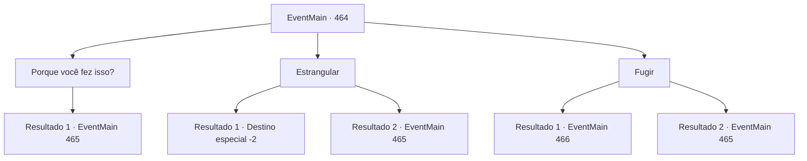

# Eventos principais · 464

[Índice da tabela](index.md) · [Índice geral](../index.md)

ID: `pt:EventMain:464` · Fonte: `EventMain4` · Versão: 1.2.47.

Mapeamento estático dos arquivos; a disponibilidade e a execução dependem do estado da run.

## Texto do evento

*Sem texto no arquivo.*

## Dados de entrada

```json
{
  "id": 464,
  "grade": 1,
  "normalGoal": "",
  "required": ""
}
```

## Mapa das escolhas



## Escolhas e resultados

### Escolha 1

Porque você fez isso?

Requisitos e outros campos da escolha:

```json
{
  "required": "1_14_10"
}
```

#### Resultado 1.1

Você consegue suprimir sua raiva e perguntar, 'por que diabos você fez isso.' Então Jimmy gritou com raiva. 

 "Este... Este... servo do demônio! 'Porque você fez isso'? Isso é o que eu gostaria de perguntar! Você sabe que humilhação eu sofri porque você estava possuído pelo demônio?"

 Irritado, ele pega um cajado e corre em sua direção com ele. Você sente muita raiva, o suficiente para fazer você perder a razão.

Continuação registrada: [Evento 465](0465.md) na mesma tabela.

```json
{
  "required": "",
  "chance": "1",
  "nextEvent": 465,
  "type": 2,
  "reward": "6_0_38",
  "place": 1
}
```

### Escolha 2

Estrangular

Requisitos e outros campos da escolha:

```json
{
  "required": ""
}
```

#### Resultado 2.1

Você sente como se algo em sua mente se rompesse. É depois que Jimmy morre em suas mãos quando você recupera o juízo. Só então você percebe que seu corpo está encharcado de suor. Você não está surpreso por ter matado um homem. Então, a voz de Kior é ouvida. 

 "Agora... alcance sua cabeça e dedique sua alma a mim."

 Você alcança a cabeça de Jimmy, como ditava sua voz nebulosa. Então você traz a alma de Jimmy e a dedica a Kior. 

 "Isso, bom... Muito bom começo."

 Ele faz uma pausa e continua suas palavras. 

 "Existem adoradores que servem a mim em uma aldeia chamada 'Kahida', não muito longe daqui. Vá encontrá-los. Eles vão ajudar na sua vingança."

 Com as palavras de Kior, você segue para a aldeia Kahida.

Continuação registrada: [Destino especial `-2`](../destinos-especiais.md).

```json
{
  "required": "",
  "chance": "1|0_5_1",
  "nextEvent": -2,
  "type": 0,
  "reward": "0_3_-5|13_4_1"
}
```

#### Resultado 2.2

Você sente como se algo em sua mente se rompesse. Você não pode conter sua raiva e estrangular Jimmy. Mas Jimmy, estrangula, resiste desesperadamente, ele agarra seu cajado e te acerta.

Continuação registrada: [Evento 465](0465.md) na mesma tabela.

```json
{
  "required": "",
  "chance": "8",
  "nextEvent": 465,
  "type": 1,
  "reward": "6_0_38",
  "place": 1
}
```

### Escolha 3

Fugir

Requisitos e outros campos da escolha:

```json
{
  "required": ""
}
```

#### Resultado 3.1

Você foge de lá às pressas. Jimmy, com o rosto contorcido de raiva, corre atrás de você. Mas ele logo fica sem fôlego e fica para trás.

 O lugar para onde você está indo é a casa de um parente em um vilarejo vizinho. Você mal chega quando o céu começa a clarear lentamente, e bate na porta com cuidado. Logo depois, a porta se abre. Quem a abre é uma mulher de meia-idade, magra. 

 "Quem é você? A essa hora..."

 Sua parente, Natasha, de repente exclama com uma expressão assustada: 

 "Oh céus...! {1}! Eu ouvi dizer que você estava morto! Como... Não, entre primeiro. Conte-me o que está acontecendo."


Continuação registrada: [Evento 466](0466.md) na mesma tabela.

```json
{
  "required": "",
  "chance": "1|0_6_1",
  "nextEvent": 466,
  "type": 0,
  "reward": ""
}
```

#### Resultado 3.2

Você tenta escapar de lá com pressa, mas Jimmy é mais rápido. Ele pega o cajado e começa a levantar para bater em você. 

 "Você... Seu servo do demônio! Vou mandar você de volta para o inferno!"

 Seu ataque nada mais é do que um golpe selvagem, mas isso por si só é ameaçador o suficiente.

Continuação registrada: [Evento 465](0465.md) na mesma tabela.

```json
{
  "required": "",
  "chance": "8",
  "nextEvent": 465,
  "type": 1,
  "reward": "6_0_38",
  "place": 1
}
```

## Referências que chegam a este evento

- [Evento 463 · escolha 3 · resultado 1](0463.md#escolha-3)
