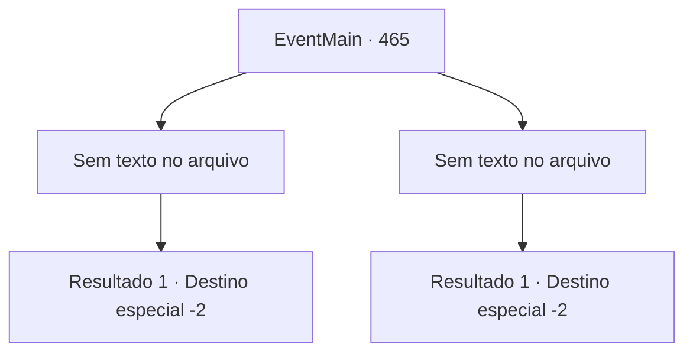

# Eventos principais · 465

[Índice da tabela](index.md) · [Índice geral](../index.md)

ID: `pt:EventMain:465` · Fonte: `EventMain4` · Versão: 1.2.47.

Mapeamento estático dos arquivos; a disponibilidade e a execução dependem do estado da run.

## Texto do evento

*Sem texto no arquivo.*

## Dados de entrada

```json
{
  "id": 465,
  "grade": 1,
  "normalGoal": "",
  "required": ""
}
```

## Mapa das escolhas



## Escolhas e resultados

### Escolha 1

*Sem texto no arquivo; o papel dessa opção depende da interface do jogo.*

Requisitos e outros campos da escolha:

```json
{
  "required": ""
}
```

#### Resultado 1.1


 "Khh... Ugh..."

 Jimmy cai no chão quando você o acerta.  Você não está surpreso por ter matado um homem.  Então, a voz de Kior é ouvida.  

 "Agora... alcance sua cabeça e dedique sua alma a mim."

  Você alcança a cabeça de Jimmy, como ditava sua voz nebulosa.  Então você traz a alma de Jimmy e a dedica a Kior.  

 "Isso, bom... Muito bom começo."

  Ele faz uma pausa e continua suas palavras.  

 "Existem adoradores que servem a mim em uma aldeia chamada 'Kahida', não muito longe daqui.  Vá encontrá-los. Eles vão ajudar na sua vingança."

  Com as palavras de Kior, você segue para a aldeia Kahida.

Continuação registrada: [Destino especial `-2`](../destinos-especiais.md).

```json
{
  "required": "",
  "chance": "1",
  "nextEvent": -2,
  "type": 2,
  "reward": "0_3_-5|13_4_1"
}
```

### Escolha 2

*Sem texto no arquivo; o papel dessa opção depende da interface do jogo.*

Requisitos e outros campos da escolha:

```json
{
  "required": ""
}
```

#### Resultado 2.1

Depois de ser espancado por Jimmy, você fugiu às pressas. Ele também está gravemente ferido, mas não pode ir atrás de você. Então, a voz de Kior é ouvida novamente. 

 "Existem adoradores que servem a mim em uma aldeia chamada 'Kahida' não muito longe daqui. Vá encontrá-los. Eles vão ajudar na sua vingança."

 Nas palavras de Kior, você segue para aldeia Kahida

Continuação registrada: [Destino especial `-2`](../destinos-especiais.md).

```json
{
  "required": "",
  "chance": "1",
  "nextEvent": -2,
  "type": 2,
  "reward": "0_0_-1|0_1_-1|0_2_1|13_4_1"
}
```

## Referências que chegam a este evento

- [Evento 464 · escolha 1 · resultado 1](0464.md#escolha-1)
- [Evento 464 · escolha 2 · resultado 2](0464.md#escolha-2)
- [Evento 464 · escolha 3 · resultado 2](0464.md#escolha-3)
