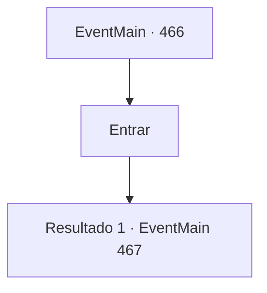

# Eventos principais · 466

[Índice da tabela](index.md) · [Índice geral](../index.md)

ID: `pt:EventMain:466` · Fonte: `EventMain4` · Versão: 1.2.47.

Mapeamento estático dos arquivos; a disponibilidade e a execução dependem do estado da run.

## Texto do evento

*Sem texto no arquivo.*

## Dados de entrada

```json
{
  "id": 466,
  "grade": 1,
  "normalGoal": "",
  "required": ""
}
```

## Mapa das escolhas



## Escolhas e resultados

### Escolha 1

Entrar

Requisitos e outros campos da escolha:

```json
{
  "required": ""
}
```

#### Resultado 1.1

Natasha leva você para dentro da casa. Ela o leva até a sala de estar, entrega-lhe uma xícara de chá e pergunta o que aconteceu. Você responde com sinceridade e pergunta se pode se esconder ali por enquanto. Natasha pensa por um instante e finalmente acena com a cabeça, com uma expressão séria. 

 "Certo. Você pode ficar aqui. Não se preocupe, apenas descanse."

  Depois de falar, ela se levanta da cadeira e diz que vai buscar água para você se lavar. Então, abre a porta que range e sai.

Continuação registrada: [Evento 467](0467.md) na mesma tabela.

```json
{
  "required": "",
  "chance": "1",
  "nextEvent": 467,
  "type": 2,
  "reward": ""
}
```

## Referências que chegam a este evento

- [Evento 464 · escolha 3 · resultado 1](0464.md#escolha-3)
