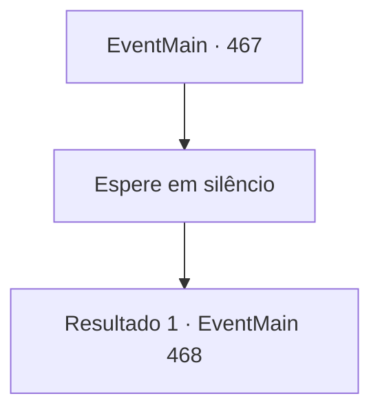

# Eventos principais · 467

[Índice da tabela](index.md) · [Índice geral](../index.md)

ID: `pt:EventMain:467` · Fonte: `EventMain4` · Versão: 1.2.47.

Mapeamento estático dos arquivos; a disponibilidade e a execução dependem do estado da run.

## Texto do evento

*Sem texto no arquivo.*

## Dados de entrada

```json
{
  "id": 467,
  "grade": 1,
  "normalGoal": "",
  "required": ""
}
```

## Mapa das escolhas



## Escolhas e resultados

### Escolha 1

Espere em silêncio

Requisitos e outros campos da escolha:

```json
{
  "required": ""
}
```

#### Resultado 1.1

Você se senta em uma cadeira e espera calmamente por Natasha. Mas depois de trinta minutos ela não volta, e você percebe algo estranho. É só então. De repente, a porta se abriu e paladinos armados entraram na casa. 

 "Por aqui! Cerquem-no e ataquem!"

 Os paladinos correm para cercar a área antes de você escapar. Natasha, que fecha os olhos com força atrás deles, é vista.

Continuação registrada: [Evento 468](0468.md) na mesma tabela.

```json
{
  "required": "",
  "chance": "1",
  "nextEvent": 468,
  "type": 2,
  "reward": "6_0_50",
  "place": 4
}
```

## Referências que chegam a este evento

- [Evento 466 · escolha 1 · resultado 1](0466.md#escolha-1)
