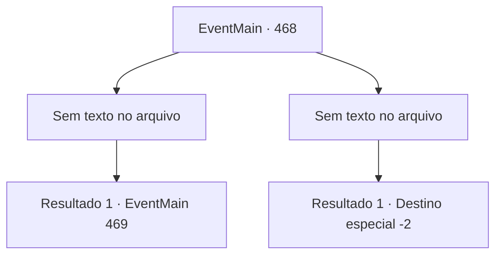

# Eventos principais · 468

[Índice da tabela](index.md) · [Índice geral](../index.md)

ID: `pt:EventMain:468` · Fonte: `EventMain4` · Versão: 1.2.47.

Mapeamento estático dos arquivos; a disponibilidade e a execução dependem do estado da run.

## Texto do evento

*Sem texto no arquivo.*

## Dados de entrada

```json
{
  "id": 468,
  "grade": 1,
  "normalGoal": "",
  "required": ""
}
```

## Mapa das escolhas



## Escolhas e resultados

### Escolha 1

*Sem texto no arquivo; o papel dessa opção depende da interface do jogo.*

Requisitos e outros campos da escolha:

```json
{
  "required": ""
}
```

#### Resultado 1.1

Você mata os paladinos e se aproxima de Natasha. Ela chora, ajoelhada com uma cara assustada. 

 "Desculpe! Me perdoe! Se eu for pega protegendo você, minha família e eu estará no mesmo barco... Não tinha nada que eu pudesse fazer!"


Continuação registrada: [Evento 469](0469.md) na mesma tabela.

```json
{
  "required": "",
  "chance": "1",
  "nextEvent": 469,
  "type": 2,
  "reward": ""
}
```

### Escolha 2

*Sem texto no arquivo; o papel dessa opção depende da interface do jogo.*

Requisitos e outros campos da escolha:

```json
{
  "required": ""
}
```

#### Resultado 2.1

Você mal foge para lá durante a emboscada dos paladinos. Felizmente, eles estão muito feridos e não podem segui-lo. Nesse momento, Kior sussurra para você: 

 "Os servos do maldito Tere ..."

 Ele murmura em uma mistura de ódio e fala novamente. 

 "Existem adoradores que servem a mim em uma aldeia chamada 'Kahida' não muito longe daqui. Vá encontrá-los. Eles vão ajudar na sua vingança."

 Nas palavras de Kior, você segue para aldeia Kahida.

Continuação registrada: [Destino especial `-2`](../destinos-especiais.md).

```json
{
  "required": "",
  "chance": "1",
  "nextEvent": -2,
  "type": 2,
  "reward": "0_0_-1|0_1_-1|13_4_1"
}
```

## Referências que chegam a este evento

- [Evento 467 · escolha 1 · resultado 1](0467.md#escolha-1)
